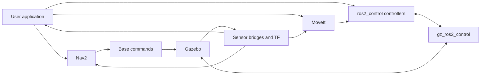

# Slide draft: Python, C++ and interactive robotics experiments

Updated 21 October 2026 from [TALK_FLOW.md](TALK_FLOW.md) and the completed webcam session.
**24 main slides + 10 backup slides.** Aim for 40 minutes of content and five minutes of questions. Markdown is the editable source; [HTML preview](SLIDE_DRAFT.html) provides coloured code, keyboard navigation and collapsible notes. PowerPoint styling comes later.

Only **On screen** goes on the slide. **Say** is draft narration. **Show / source** contains production instructions, commands, evidence and outstanding decisions. Placeholders are intentional production slots, not claims that a video already exists. Commands require this repository checkout. No benchmarks were rerun for this editorial revision.

| Slides | Minutes | Section |
| --- | --- | --- |
| 01–04 | 0–3 | Robotics scene and language vote |
| 05–08 | 3–9 | cppyy, kit and meaningful cache example |
| 09–13 | 9–15 | rclcppyy, copies, controller and robot outcome |
| 14–15 | 15–19 | Agents and retained interactive resources |
| 16–17 | 19–27 | Recorded-data experiment |
| 18–20 | 27–33 | Webcam, gestures and native rain |
| 21–23 | 33–38 | Runtime costs and implementation brief |
| 24 | 38–40 | Close |
| 25–34 | Questions | Backup |

Production priorities: review the local rclcppyy characterization and select its final callback excerpt for slide 09; record robot footage matching slide 13's evidence; rehearse both notebook starts; record the bounded MCAP and webcam sequences; add public links on slide 24. See media cues under each slide. Full previous material is preserved in [SLIDE_DRAFT_PREVIOUS.md](SLIDE_DRAFT_PREVIOUS.md). The older script and speaker notes remain source material; this draft controls the new order.

---

## Slide 01: Python, C++ and experiments we can keep changing

**On screen**

cppyy · cppyy_kit · ROS 2

Try an idea against real data.
Keep the useful code, examples and requirements.

**Say**

I usually work in robotics. Sensors, control, autonomous systems, a lot of data. We are at ROSCon, so this probably sounds familiar. I want to show you some things we can build from Python using C++ underneath. Then I want to ask what this is useful for when an agent can write the bindings for us.

**Show / source**

Title slide. Presenter name and affiliation: fill before template transfer. Use a still from the TIAGo scene. About 30 seconds.

---

## Slide 02: Here is our playground

**On screen**

[Robot scene, arm motion and camera view]

A simulated TIAGo PRO in Gazebo

Find an object. Move it. Inspect the result.

**Say**

For today, I set up a simulated robot with some typical ROS 2 software. Here is
what it looks like. We have a mobile base, two arms, cameras, and some objects on
a table. We want the robot to find an object and move it. We will keep this same
robot as we change how we implement and connect its software. First I just want
you to recognise the scene. Later we will look at the cloud and image that the
application actually uses, and then at what happens when the gripper makes
contact with an object.

**Show / source**

Capture a short overview from the [source simulator](next_steps/tiago_pro_jazzy/README.md).
Include base motion, a separate arm motion and the camera view. Label the footage
“Gazebo simulation”. Do not present a navigation-enabled overview as the launch
configuration for every later demo. The existing
[perception overlay](next_steps/pick_place/evidence/perception_overlay.png) is a
camera-view fallback. Do not start the full pick-and-place sequence on this slide.

---

## Slide 03: Familiar robot software

**On screen**



Conceptual software diagram

**Say**

The software looks familiar too. There is a simulator, sensor and hardware
interfaces, controllers, navigation, motion planning, and our application on
top. On a real robot, hardware drivers occupy the boundary where we have
simulated hardware here. At any of these points, you might want to try a small
feature, replace a module, or build a whole new application. Today we will
experiment in Python, reuse C++ libraries, and move selected work into native
code when it helps. Keep this diagram in mind as we move between those layers.

**Show / source**

Render the Mermaid diagram. It describes roles, not process ownership or an
exact ROS graph. MoveIt and Nav2 are available playground components; several
custom demos disable them. Source: [talk opening](TALK_SCRIPT.md#1-set-the-scene).

---

## Slide 04: What do you reach for first?

**On screen**

Which language do you prefer when you need to get something working quickly?

Python · C++ · Rust

**Say**

Before we start, which language do you prefer when you need to get something
working quickly? Python? C++? Rust?

[Pause for hands.]

If Python wins: Good, I can spend less time defending the syntax and more time
showing what we can connect it to.

If C++ or Rust wins: Fair enough. Keep using it where it works for you. I want
to show why Python can still be useful for configuring, composing and exploring
those systems.

Python is a convenient orchestration language. We can write the task in it,
inspect intermediate values, and call code implemented elsewhere.

**Show / source**

Keep this to the short show of hands proposed in the
[talk script](TALK_SCRIPT.md#2-get-a-sense-of-the-room). Do not change the demo
configuration in response to the vote.

---

## Slide 05: First, plain cppyy

**On screen**

```python
import cppyy
import numpy as np

cppyy.cppdef("""
double sum_sq(const double* x, size_t n) {
    double sum = 0;
    for (size_t i = 0; i < n; ++i) sum += x[i] * x[i];
    return sum;
}
""")
x = np.array([1., 2., 3.], dtype=np.float64)
print(cppyy.gbl.sum_sq(x, x.size))
```

```text
14.0
```

**Say**

Here is the smallest example. Python supplies an array. We give cppyy a C++
function, then call that function through its Python proxy. The loop here is
C++. The call is ordinary Python syntax. That is already useful: I can try a
native operation without first writing a separate extension package. I chose a
sum of squares because we can see the whole function and check the answer.
NumPy already knows how to do this operation, so this slide is about the
interface, not a claim that this is the best way to sum an array.

**Show / source**

Use the complete code as a prepared terminal script. Expected output is `14.0`.
Code source: [talk script example](TALK_SCRIPT.md#5-from-cppyy-to-cppyy_kit).
Keep the same function and input on the following slide.

---

## Slide 06: The same function with cppyy_kit

**On screen**

```python
import numpy as np
from cppyy_kit import cpp
from cppyy_kit.numpy_types import NDArray

@cpp
def sum_sq(x: NDArray[np.float64]) -> float:
    """
    double sum = 0;
    for (size_t i = 0; i < x_size; ++i) sum += x[i] * x[i];
    return sum;
    """

print(sum_sq(np.array([1., 2., 3.], dtype=np.float64)))
```

```text
14.0
```

**Say**

With the kit, I put the C++ body in a docstring and describe the input in the
annotation. This is still C++ source. We are not translating the Python
function into C++. The annotation describes the buffer contract; the kit
supplies the entry point and the array size used by this loop. The function
then looks like a Python callable to the rest of the application. For a small
experiment, that keeps the native operation close to the Python code that uses
it. The result is the same fourteen we just checked.

**Show / source**

Prepared code and terminal output. Preserve the C++ docstring exactly.
Implementation: [cpp decorator](../cppyy_kit/_cpp.py).

---

## Slide 07: What the kit takes care of

**On screen**

```text
Python API and buffer contract
             ↓
Generated entry point + compiled artifact cache
             ↓
C++ function or existing C++ library
```

Headers · libraries · buffers · callbacks · ownership · shutdown

**Say**

cppyy gives us a lot. It also exposes integration details that matter in a
robot application: loading headers and libraries, startup work, buffers,
callback lifetimes, and shutting native objects down in the right order.
cppyy_kit started as reusable helpers for those details. The aim is to keep
experiments small without rediscovering the same integration failures. There
is still compilation on a cold path. On later runs we can load the compiled
function. cppyy can already load existing libraries and use precompiled
facilities. The contribution here is a convenient cache and integration
workflow for these examples.

**Show / source**

Use the diagram, then highlight the cache between the Python API and native
implementation. Sources: [kit caching guide](../docs/FREEZE.md),
[cppyy library loading](https://cppyy.readthedocs.io/en/latest/toplevel.html),
[cppyy startup](https://cppyy.readthedocs.io/en/latest/starting.html).

---

## Slide 08: A cache saves work when there is work to save

**On screen**

Same Eigen operation · fresh Python process each time

| Prepared path | Whole-process median, 3 launches |
|---|---:|
| Vanilla cppyy + its standard PCH | 1.695 s |
| Same code + prepared Eigen PCH | 1.512 s |
| cppyy_kit + compiled function cache | **0.319 s** |

**5.3× faster repeat startup** with the function cache.

First kit cache-building run: **3.948 s**.
Separate Eigen PCH preparation: **1.743 s**.

**Say**

Now there is a difference we can point to. Plain cppyy takes about one point
seven seconds to start, compile, calculate and check the result. With the
compiled function ready, the kit takes about point three two seconds.
The first kit run costs more, about four seconds, because it prepares that
library. We pay that once for this cached implementation and reuse it when we
restart. I also measured a precompiled Eigen header separately. That helps a
little here, but it still leaves the expression and solver to compile. Most
of this example's saving comes from keeping the compiled function. So we have
two useful tools: reuse parsed headers, and reuse compiled implementations.

**Show / source**

Run from the repository root:

```bash
pixi run python roscon_uk_2026/slide_assets/eigen_startup/benchmark.py
```

Recorded whole-process samples, rounded from [results.json](slide_assets/eigen_startup/results.json):

```text
vanilla cppyy:       1.689  1.704  1.695 s
prepared Eigen PCH:  1.512  1.511  1.554 s
kit function cache:  0.330  0.315  0.319 s
```

Use [terminal.txt](slide_assets/eigen_startup/terminal.txt) for actual terminal
output and [the run guide](slide_assets/eigen_startup/README.md) for individual
stage commands. All paths run the same C++ source and fixed arrays and check
against NumPy; maximum absolute error is below `2e-16`. The kit startup hook is
disabled, and inherited PCH settings are removed. Baseline and function-cache
runs use cppyy's own existing standard PCH. The Eigen-PCH path explicitly
selects its separate artifact. OS caches remain warm. Process timing includes
input preparation, validation and shutdown. Highlight the one-time cost as well
as the repeated-launch saving. The warmed-call measurements remain available in the previous draft and benchmark sources.

---

## Slide 09: rclcppyy performance depends on the execution path

**On screen**

Local x86-64 · ROS 2 Jazzy · CycloneDDS · direct C++ versus stock rclpy

| Workload | CPU time relative to rclpy | Closed-loop throughput relative to rclpy |
| --- | ---: | ---: |
| Pub/sub relay | 0.228× (77% less relay CPU) | 2.925× |
| Service client | 0.218× (78% less CPU) | 2.634× |
| Action client | 0.261× (74% less CPU) | 1.016× |

Local characterization from the project handoff; not a universal speedup.
Default compatible mode retains stock execution on these paths.

**Say**

There are several ways to use rclcppyy, and they do not have the same performance. In these local measurements, the direct C++ relay used about a quarter of the relay CPU time and delivered nearly three times the closed-loop throughput. The action client also used less CPU, but completed goals at almost the same rate. CPU savings and faster completion are different results. These numbers apply to the explicit direct paths and the measured workloads. Adding compatible activation to arbitrary rclpy code does not promise this improvement.

**Show / source**

Source: [rclcppyy handoff, Current CPU Evidence](../../rclcppyy/docs/RCLCPPYY_RESTART_HANDOFF.md#current-cpu-evidence). Checkout inspected at `2280926`; the recorded runs predate that snapshot and have their own provenance. See [talk summary](RCLCPPYY_TALK_SUMMARY.md) for the fuller table and caveats. The handoff is the source of these ratios; the underlying relay/service artifacts were not independently reanalysed during slide editing. Its release-performance gates remain open. Present as local characterization, or replace with reviewed repeated results before publishing a general performance claim.

CPU ratios are candidate CPU time divided by stock CPU time for the benchmark window; throughput ratios are candidate divided by stock. They are not CPU utilisation percentages or maximum sustainable streaming rates. Relay protocol: two processes, UInt64, one request outstanding, reliable KeepLast(1), same transform. Action client measures a different contract. Do not merge results across protocols into one overall speedup.

---

## Slide 10: Reach the native rclcpp capabilities from Python

**On screen**

| Native capability | What it enables |
| --- | --- |
| Generated C++ message objects | Pass compatible messages directly to C++ operations |
| rclcpp intra-process communication | Native ownership-transfer paths between colocated C++ nodes |
| rclcpp component container | Load existing registered C++ components in the managed process |
| Native callbacks and fused operations | Keep selected per-message work outside Python |
| Loaned-message API access | Borrow/publish where the publisher and RMW support it |
| C++ type adapters and raw APIs | Integrate application-native types and C++ facilities |

Explicit native mode. Ownership and middleware support still matter.

**Say**

The other part is capability. We can hold the actual C++ message and use it with compatible native code. We can create rclcpp nodes with intra-process communication, load registered C++ components, and run selected callbacks entirely in C++. Some facilities come through the lower-level rclcpp kit. Loaning depends on the middleware and message type, so we query support. None of this means that every boundary becomes zero-copy. And lifecycle, actions and multithreaded executors are already available in rclpy; the difference here is access to the C++ objects and execution path.

**Show / source**

Use the native-session example in [rclcppyy README](../../rclcppyy/README.md), with `ros.create_node(..., use_intra_process=True)`, `create_native_component_manager()` and `create_fused_pipeline()`. This list is about capabilities outside ordinary rclpy's public object model, not impossibility through custom Python extensions. Domain type adapters and native callback factories are `rclcpp_kit` facilities available through the explicit native workflow. Query `session.capabilities` and `rclcppyy.publisher_capabilities()`.

[Backend selection](../../rclcppyy/docs/backend-selection.md#native-lane), [ROS composition documentation](https://docs.ros.org/en/jazzy/p/composition/index.html). The component container loads registered AOT C++ plugins, not arbitrary Python classes. Intra-process and loaned-message paths are separate mechanisms. Keep owner lifetimes valid when borrowing buffers; middleware transport, ROS/PCL conversion and outputs can still copy.

---

## Slide 11: A Python controller inside ros2_control

**On screen**

```python
class GentleServo:
    def configure(self, joints, options):
        self.speed = options.get("speed", 0.2)  # rad/s

    def activate(self, measured):
        self.target = list(measured)

    def set_target(self, positions):
        self.target = list(positions)

    def update(self, measured, dt):
        step = self.speed * dt
        return [
            q + max(-step, min(step, goal - q))
            for q, goal in zip(measured, self.target)
        ]
```

Controller-specific Python · reduced teaching example

**Say**

So far we have called native functions. Now let us implement behaviour that a
native framework calls. Here is a Python controller for a ros2_control bridge.
On activation it holds the measured state. A target changes where it wants to
go. Each update returns a bounded increment towards that target. This is all
the controller-specific code in the teaching example. control_kit supplies the
reusable bridge into the real controller manager. For the actual robot demo we
use the validated PositionServo, which also handles target validation and joint
limits. I will show the bridge next so we can see where this short class fits.

**Show / source**

Exact teaching code from [speaker notes](SPEAKER_NOTES.md#one-slide-the-controller-specific-python).
Use a large code font and reveal `update` last. The increment is bounded relative
to feedback; it does not guarantee physical speed. Live/recorded controller:
[PositionServo](../control_kit/demos/python_position_controller.py), run using the
[Gazebo Python controller guide](next_steps/pick_place/README.md#python-controller-inside-gazebo).
Do not replace the validated class with this teaching class on stage.

---

## Slide 12: And here is the glue

**On screen**

```yaml
gentle:
  ros__parameters:
    type: control_kit_python/PythonController
    joints: [joint1, joint2]
    python_path: /absolute/path/to/controllers
    python_module: gentle_servo
    python_class: GentleServo
    python_options: '{"speed": 0.2}'
```

```python
from control_kit.python_control import install_python_controller_plugin
install_python_controller_plugin("/absolute/path/to/overlay")
```

```cpp
auto result = checked(PyObject_CallMethod(controller_, "update", "Od", values.get(), dt));
```

**Say**

The configuration selects a module, a class, and the joints it controls. The
export helper builds or reuses one bridge and writes the plugin metadata. The
controller manager discovers that plugin through its overlay. Here is the
actual C++ call into Python during update. The bridge acquires the GIL, passes
feedback and the period, checks the returned positions, and writes the command
interfaces. CPython makes embedding possible. control_kit supplies that bridge.
cppyy_kit builds and caches it. A conventional ROS package could provide the
same Python API; this example reduces the build and integration work we maintain.

**Show / source**

Use sequential builds: configuration, export, then the C++ call. YAML names and
paths are illustrative, as in [speaker notes](SPEAKER_NOTES.md#next-slide-show-the-glue).
Real invocation: [python_controller.cpp](../control_kit/control_kit/python_controller.cpp:240).
Export: [python_control.py](../control_kit/control_kit/python_control.py:55).
The manager must inherit the overlay through `AMENT_PREFIX_PATH` before startup;
stock interface owners must be switched out. Show a prepared wrist-motion clip
from the validated servo. Python executes inside Gazebo's manager with the GIL;
this is not hard real-time.

---

## Slide 13: Put the pieces into a robot task

**On screen**

[Pick, lift, transfer, release and retreat recording]

Placo contact run · Gazebo simulation

84.8 mm object lift · 16.8 mm placement error

Physical contact · no attachment assist · one successful run

**Say**

Now use those task goals for the same pick-and-place sequence. Watch the
object, not just the arm. It lifts after the fingers close, moves with the
hand, and remains at the placement location after release and retreat. In this
recorded Placo run the measured lift was 84.8 millimetres and placement error
was 16.8 millimetres. Attachment assistance was disabled. This is one successful
run, so it tells us that this task completed under these conditions. It is not
a success-rate measurement. The useful result is that the perception,
controller and task sequence produced an observed contact pick and place.

**Show / source**

Capture or select footage matching
[runs/placo-contact.json](next_steps/pick_place/runs/placo-contact.json).
If that exact recording is unavailable, show the JSON-derived result with a
clearly labelled illustrative robot still. Do not present footage from a
different assisted run as this result. Retain the “one successful run” caption.
Evidence discussion: [RESULTS.md](next_steps/pick_place/RESULTS.md#placo-controller).
Do not append an unvalidated handover demonstration.

---

## Slide 14: What changes when an agent can write the bindings?

**On screen**

```text
C++ source + CMake + bindings + Python API
                   ↓
            An agent can write this
```

What still takes work?

Choosing the behaviour. Inspecting results. Handling failures.

**Say**

This is the question I wanted to come back to. Writing a small extension used to be a substantial part of the friction. Now I can ask an agent to write the C++, CMake, bindings and a convenient Python wrapper. So I do not think “fewer build files” is enough of an argument on its own. I still need to figure out what I actually want, try it against the data, and decide whether the result is right.

**Show / source**

Use a small diagram of the conventional extension route. Present reduced workflow effort as a hypothesis, not a measured agent-productivity result. Source: [discussion](AGENT_LIVE_EXPERIMENTS.md). About 90 seconds.

---

## Slide 15: Keep the experiment alive

**On screen**

```text
Agent terminal ←→ persistent marimo interpreter
                              │
                  camera / data / models / state
                              │
                  Python + native operations
                              │
                     notebook or Viser
```

Edit the operation. Inspect the result. Retain the resources.

**Say**

I think there is something useful here. We already have the data loaded, the libraries available, and a result we can look at. The agent can change what we ask the system to do while those resources stay alive. Marimo provides the interpreter and editing interface. cppyy provides access to C++. The kit gives us reusable integration and selected native operations. We need all those parts to work together.

**Show / source**

Draw as a simple architecture diagram in the eventual template. Preview the actual split-screen layout. [Recorded session](next_steps/agent_session/NOTEBOOK.md), [live session](next_steps/webcam_session/toolbox/rendering/SESSION_HANDOFF.md). Explain the separate MediaPipe worker only if asked; put dependency details in backup.

---

## Slide 16: Recorded data: find the red object

**On screen**

[MCAP camera image and point cloud, beside the agent]

“Find the red object on this table.
Show which points belong to it.”

Fixed input. Visible selection. Repeatable result.

**Say**

Let's start with recorded data. The robot is looking at this table. We have images, depth, calibration and transforms in the recording. I want the red object, and I want to see which points the software selected. We can inspect that result rather than just accept that a function returned a box.

**Show / source**

DEMO / RECORDING: open the [table notebook](next_steps/agent_session/README.md#notebook), port 2718. Start with all colours, 8 mm voxels, minimum cluster size 12 and the broad ROI documented there. Show three candidates. Then ask for red. The recording contains 273 frames per RGB/depth/cloud stream over 14.574 seconds. Use the accepted snapshot for reproducibility. Keep the split screen legible; enlarge the result when explaining it. First part of the eight-minute recorded-data slot.

---

## Slide 17: Refine the question, then replay the answer

**On screen**

```text
Three candidates
      ↓ colour + region + voxel / cluster settings
One red cluster: 178 points
      ↓ saved notebook, fresh process
Same selected result
```

Keep examples where the target is absent or ambiguous.

**Say**

The first request is rarely the whole requirement. Here we refine the region and the filtering, and watch what happens. The input arrays and interpreter stay alive while we make those changes. We then saved the notebook and checked the accepted result in a fresh process. That gives us more than a screenshot: we have inputs and code that reproduce the selection. We should also keep a case where the object is absent, so the next implementation has to handle that.

**Show / source**

Show the actual controls and selected cloud, then a short terminal excerpt from [retention evidence](next_steps/agent_session/evidence/retention.json). Three revisions retained inputs; accepted settings are 4 mm voxels, minimum cluster size 20 and the refined ROI in [README](next_steps/agent_session/README.md). Prepare the no-target example before presenting it as demonstrated. Capture one correction, not a long terminal transcript.

---

## Slide 18: Now keep the camera running

**On screen**

[Live RGB + relative depth + foreground cloud]

Agent on the left. Viser on the right.

Camera, calibration, model and viewer remain loaded.

**Say**

That was recorded data. Now the input keeps changing. We did this exercise with an agent and a webcam. We started with depth, then added faces and hands, selected the foreground and made the view interactive. For the talk, I will start from that working session and change one bounded thing. We do not need to build the whole application while you wait.

**Show / source**

LIVE / VIDEO: [current notebook and handoff](next_steps/webcam_session/toolbox/rendering/SESSION_HANDOFF.md). Startup and agent prompt: [rendering README](next_steps/webcam_session/toolbox/rendering/README.md). Keep marimo at 2721 open in the background and Viser at 8768 beside the terminal. Use presenter/nearby volunteer framing. Set pose and raised-hand filtering off initially. Depth is relative; webcam calibration corrects geometry, not metric scale. Begin six-minute webcam slot.

---

## Slide 19: The details become the specification

**On screen**

One fist: pan.
Two fists: zoom around a fixed target.
Open hand: release.

Miss a detection: pause, then recover without a jump.

**Say**

“Move the view with my hand” sounds simple. But then we find the details. What if a detection disappears for a frame? What if there are two hands? What should stay fixed when we zoom? We worked those rules out while looking at the result. Those are useful requirements to keep, because another implementation needs to preserve the behaviour, not just draw some landmarks.

**Show / source**

Demonstrate pan, zoom and release. Ask for one bounded control or behaviour change with the expected outcome stated aloud. Example: adjust pan sensitivity using the existing control; if editing a rule, rehearse the exact cell first. The implementation tolerates two missing processed detections, pauses during gaps and resets the baseline on recovery. Source: `hand_drag_logic` and `hand_drag_runtime` in [notebook](next_steps/webcam_session/toolbox/rendering/depth_notebook.py). Keep full runtime cells alive.

---

## Slide 20: A useful native operation: rain on the depth surface

**On screen**

[Rain bouncing on the selected foreground]

```python
# The retained native kernel is defined with @rain_cpp(nogil=True).
hits = rain_step(rain_particles,depth,mask,rain_lines,rain_colors,rain_rng,
                 count,depth.shape[1],depth.shape[0],
                 float(K[0,0]),float(K[1,1]),float(K[0,2]),float(K[1,2]),
                 *[float(v) for v in head],dt,
                 float(np.clip(controls.get("rain_gravity",5.0),0,30)),
                 float(np.clip(controls.get("rain_speed",2.0),0.1,10)))
```

Python: controls and orchestration
C++: particle step with retained buffers

Recorded native call median: about 0.20 ms

**Say**

This one is a bit silly, but it gives us a useful operation to put in C++. We move particles, project them into the depth image, check for collisions and bounce them. Python still controls the experiment. The C++ step releases the GIL, and we retain the particle buffers. Now we can change the effect while watching it run, and we can point to exactly where cppyy_kit is involved.

**Show / source**

The displayed call is extracted from the running simulation cell; its variables are retained buffers and per-frame geometry. Before template transfer, decide whether to pair it with an exact excerpt from `rain_native_kernel`; preserve its @cpp docstring. Show the running effect, then highlight the native call and buffer ownership. [Handoff](next_steps/webcam_session/toolbox/rendering/SESSION_HANDOFF.md): about 58 simulation steps/s, 29 publications/s, median kernel call 0.20 ms in a recorded sample. Combined perception was about 9–15 fps depending on features; capture near 30 fps. These are different rates. The effect collides with estimated visible depth, not a complete physical scene. Record the same bounded sequence for fallback.

---

## Slide 21: The interactive runtime has a cost

**On screen**

Eigen experiment on this machine

| Process state | RSS |
| --- | ---: |
| Cached-kit path, after first call | 203.4 MiB |
| Eigen + nanobind, after first call | 36.7 MiB |

cppyy import added about 164 MiB in this harness.

Startup · deferred compilation · ownership · GIL · native failures

**Say**

There is a compiler runtime in this process, and that costs memory and time. In this experiment, the cached-kit process used about 203 MiB after its first call; the compiled nanobind extension process was about 37 MiB. First use can also do deferred work. Native objects have lifetimes, and native mistakes can take the interpreter down. We should include those costs when choosing how to deploy the result.

**Show / source**

Source: [runtime measurements](slide_assets/runtime_costs/README.md), 20 October, medians of three fresh processes, prepared function cache, warm OS caches. RSS is whole-process resident memory, not library file size or incremental memory. The cppyy-import delta is a different measurement. Command: `pixi run python roscon_uk_2026/slide_assets/runtime_costs/measure.py` after documented build preparation. Keep full tables in backup. Do not attribute all first-call time to compilation.

---

## Slide 22: We can keep the performance in an offline build

**On screen**

Same cloud operation: 307,200 points

| Path | Recorded time per call |
| --- | ---: |
| Original GCC native build | about 0.430 ms |
| cppyy JIT | about 0.360 ms |
| Offline Clang native build | about 0.360 ms |

Same source. Nanobind wrapper unchanged in the offline comparison.

**Say**

We found something interesting in the measurements. The JIT version was faster than the original native build. It was tempting to call that a binding advantage. We inspected the generated code and found different vectorisation. An offline Clang build reached the same speed with the wrapper unchanged. So we can preserve this result in an ordinary compiled library. The experiment helped us discover what to look for.

**Show / source**

Source and exact benchmark conditions: [CODEGEN.md](slide_assets/runtime_costs/cloud/CODEGEN.md), [cloud comparison](slide_assets/runtime_costs/cloud/README.md). Use recorded values, not a fresh on-stage benchmark. No evidence here of specialization to particular transform values or cloud size. Keep disassembly and flags in backup. Caption the chart as this kernel on this machine, not a general compiler ranking.

---

## Slide 23: Give the next agent more than a request

**On screen**

```text
Representative inputs + reviewed outputs + failure cases
                         +
Reference code + interfaces + deployment constraints
                         ↓
           Dedicated implementation agent / team
                         ↓
        Evaluate behaviour, speed and resource use
```

Examples and test data; training data when learning is appropriate.

**Say**

By now we have figured out more precisely what “works” means. We have representative inputs, corrections, failure cases and a working reference. Give all of that to a dedicated agent or team and ask for the best implementation for the target. That might be a compiled C++ library, Rust, or an existing library. The important thing is that we have concrete criteria to evaluate it. Keep some evaluation examples separate from the cases used during the experiment.

**Show / source**

Show one actual saved input/output record alongside the accepted notebook source. [Webcam evidence](next_steps/webcam_session/toolbox/rendering/evidence/interactive_session_2026_10_21.json), [recorded replay](next_steps/agent_session/evidence/retention.json). Distinguish the demonstrated saved-notebook replay and offline kernels from the proposed broader agent handoff. A reference output needs review before becoming an expected answer. About two minutes.

---

## Slide 24: Make the next question easy to try

**On screen**

Explore → specify → implement → evaluate

cppyy: dynamic access to C++
cppyy_kit: reusable integration and native operations
Persistent sessions: feedback against retained data and state

[Repository / demo links / QR]

Questions

**Say**

I think there is still a place for this, even when writing code gets much easier. We can move up a level: ask a question, try it against the data, inspect what happened and refine it. Then keep what we learned so the next implementation has a clear job. That is the workflow I want to make easier. Thank you.

**Show / source**

Add verified public repository and demo URLs when preparing the final template. Do not encode a local filesystem path in the QR. Finish spoken content around minute 40, leaving five minutes for questions. Next slides are backup only.

---

## Slide 25: Backup: other routes from Python to native code

**On screen**

| Route | Useful starting point |
|---|---|
| NumPy / SciPy / existing bindings | An operation already exists |
| Numba | Supported numerical Python / NumPy loops |
| Cython | Typed Python-like source and native interfaces |
| pybind11 / extension | An explicit C++ API and build workflow |
| cppyy | Dynamic access to C++ APIs and templates |

**Say**

These solve different problems, and we can combine them. First I would check
NumPy, SciPy, or a library with bindings already available. An array expression
can remove a Python loop without adding a new C++ interface. Numba is useful
when the loop fits its supported numerical subset. Cython and a conventional
extension give us other ways to define the native boundary. What interests me
about cppyy is access to the C++ API while I am still working interactively in
Python. That includes code I write and libraries that already exist. We still
need to measure the operation we care about.

**Show / source**

Source links for the deck footer: [NumPy broadcasting](https://numpy.org/doc/stable/user/basics.broadcasting.html),
[Numba NumPy support](https://numba.readthedocs.io/en/stable/reference/numpysupported.html),
[Cython compilation](https://docs.cython.org/en/latest/src/userguide/source_files_and_compilation.html),
[pybind11](https://pybind11.readthedocs.io/en/stable/index.html),
[cppyy](https://cppyy.readthedocs.io/en/latest/). These describe scope, not a
performance ranking.

---

## Slide 26: Backup: the Eigen operation

**On screen**

A small joint step for a seven-joint arm

```cpp
#include <Eigen/Core>
#include <Eigen/Cholesky>

void joint_step(const double* jacobian, const double* delta,
                double damping, double* output) {
    using Jacobian = Eigen::Matrix<double, 6, 7, Eigen::RowMajor>;
    Eigen::Map<const Jacobian> J(jacobian);
    Eigen::Map<const Eigen::Matrix<double, 6, 1>> dx(delta);
    Eigen::Matrix<double, 6, 6> A = J * J.transpose();
    A.diagonal().array() += damping * damping;
    Eigen::Map<Eigen::Matrix<double, 7, 1>> dq(output);
    dq = J.transpose() * A.ldlt().solve(dx);
}
```

Python supplies `J` and `dx`. Eigen computes `dq`.

**Say**

Okay, summing three numbers is useful to see the syntax. Now let us give it
something closer to robotics. We have a Jacobian, a small change we want at the
hand, and we want a joint increment. Eigen already has the matrix operations
and the solver. This is the whole native operation. We map the NumPy buffers,
form the damped system and solve it. The interesting cost for this part of the
talk is bringing in Eigen and compiling this expression each time I restart
my Python program. That gives the cache something useful to save.

**Show / source**

Use [step.cpp](slide_assets/eigen_startup/step.cpp). The operation is
`dq = J.T @ solve(J @ J.T + damping² I, dx)`, with a 6-by-7 row-major Jacobian.
The [executable example](slide_assets/eigen_startup/demo.py) supplies fixed input
and checks the output against NumPy. Keep the code visible; point to the includes
and the `ldlt().solve` expression. This sets up the later admittance example.

---

## Slide 27: Backup: the cached Eigen entry point

**On screen**

Vanilla cppyy:

```python
import cppyy
cppyy.add_include_path(include)
cppyy.cppdef(source)
```

cppyy_kit:

```python
from cppyy_kit import cppyy, cppdef_cached
cppdef_cached(
    source,
    decls='void joint_step(const double*, const double*, double, double*);',
    include_paths=[include],
    name='slide_joint_step',
)
```

Same call:

```python
cppyy.gbl.joint_step(J, dx, 0.05, dq)
```

**Say**

Here is the change on the Python side. Both versions get exactly the same C++
source. With plain cppyy, we compile it in this process. With the kit, we also
give it the function declaration. That lets it separate the small interface
Python needs from the Eigen implementation. The first run prepares a shared
library. The next process loads that library and exposes the declaration.
I still have the same Python call, and I have not added a CMake project or
written a binding module. That is a concrete bit of work the kit handles for us.

**Show / source**

`source` is the text of `step.cpp`; `include` is the environment's `include/eigen3`
directory. These are the two branches of [demo.py](slide_assets/eigen_startup/demo.py).
Show `cache.reason: miss-built` on the first kit run and `cache.cached: true` on
the next. The full runner records the selected PCH and verifies every result.

---

## Slide 28: Backup: point-cloud processing

**On screen**

```text
Cloud → finite points + ROI → voxel centroids
      → table plane → object clusters
```

```cpp
pcl::VoxelGrid<pcl::PointXYZ> voxel;
voxel.setInputCloud(roi);
voxel.setLeafSize(c.leaf, c.leaf, c.leaf);
voxel.filter(*down);
```

**Say**

Now we can give this a useful job. Reduce the point cloud, remove the table,
and group the remaining points. Here is the native voxel filter inside the
cloud stage. We set a grid size and ask PCL to produce a centroid for each
occupied voxel. The rest of this stage finds the tabletop and extracts
clusters above it. Python supplies configuration and receives the result. I
want to see those intermediate outputs before asking the robot to move. If I
change the voxel size, do I still have enough detail to distinguish the
objects, and does the selected cluster still make sense?

**Show / source**

Code excerpt: [cloud.cpp](next_steps/pick_place/native/cloud.cpp).
Show the recorded cloud and intermediate objects beside the code. Capture the
live native-stage outputs, or run the recorded fallback from the `pick_place`
directory:

```bash
pixi run --manifest-path ../../../pixi.toml -e pick-place replay-pick-place
```

Source and result owner: [perception.py](next_steps/pick_place/perception.py).
Keep recorded cloud coordinates labelled `base_link`; live pipeline outputs
are transformed into `odom`.

---

## Slide 29: Backup: voxel measurement and copy boundaries

**On screen**

| Same recorded input, 8 mm grid | Median |
|---|---:|
| NumPy | 15.34 ms |
| PCL, including boundary copies | 1.31 ms |

49,695 input points → 9,181 centroids in both implementations

Maximum centroid difference: 2.38 × 10⁻⁷ m

**Say**

This is the numerical comparison I promised. Both implementations receive the
same finite points from the recorded region of interest and use an eight
millimetre grid. Both return 9,181 centroids. The maximum difference between
matched centroids is about two times ten to the minus seven metres. On this
recorded measurement, the NumPy median is 15.34 milliseconds and PCL is 1.31
milliseconds, including the copies at the PCL boundary. That is a useful
improvement for this operation. It does not tell us that every PCL operation,
every image operation, or the whole ROS application improves by that amount.

**Show / source**

Use a two-bar chart with a zero origin, units in ms and values printed on bars.
Evidence: [replay_evidence.json](next_steps/pick_place/replay_evidence.json),
`voxel_comparison`. Source fixture: `next_steps/pick_place/sample.npz`.
Keep this measurement separate from `native_loading_and_first_calls_ms` and the
full cloud stage. Do not label these numbers end-to-end ROS latency.

---

## Slide 30: Backup: whole-body goals

**On screen**

```python
controller.set_goal('gripper_left_grasping_link',
                    position=(-2.85, 2.23, 1.20))
controller.set_goal('gripper_right_grasping_link',
                    orientation=(0., 0., 0., 1.))
controller.set_elbow_goal('left', (-2.95, 1.8, 1.0), weight=.03)
controller.look_at((-2.85, 2.23, 1.05))

command = controller.step(measured_joint_positions,
                          measured_base_xy_yaw, dt=.05)
robot.command(command, duration=.05)
```

Positions: `odom`, m · orientations: XYZW quaternions

**Say**

An arm target becomes more useful when I can also express posture, gaze,
orientation and how much I want the torso or base to move. Here we ask for a
left-hand position, a right-hand orientation, a softer elbow goal, and a gaze
target. Those are different task choices we can change from Python. The
controller uses measured joint and base state to calculate the next command.
The default motion costs favour arm motion before torso and base motion.
Those are weighted preferences, not a strict priority hierarchy. The base
being available to the solver does not mean every grasp needs the base to move.

**Show / source**

Exact task API calls from [README WBC examples](next_steps/pick_place/README.md#change-whole-body-tasks-from-python),
with line wrapping and the optional obstacle setup omitted. Controller setup
requires a URDF and measured state as shown in that guide. Capture separate
position, orientation, elbow and gaze goal changes if available. Do not claim
those task changes all occur in the final grasp recording.

---

## Slide 31: Backup: the Placo solver

**On screen**

```python
from placo_controller import PlacoWholeBodyController as WholeBodyController

controller = WholeBodyController(urdf_text)
```

Same task API → Placo's existing Python bindings → native solver

WBC runs outside the ros2_control update loop.

**Say**

We explored a small custom implementation and also integrated Placo. If an
existing solver gives us the behaviour we need, we should use it. This changes
the backend while keeping the task interface useful to the application. Placo
already has Python bindings, so we use those. cppyy_kit still handles the
native perception integration elsewhere in the application. The whole-body
controller runs outside the ros2_control update loop and sends commands to the
existing controllers. The separate Python plugin example did not move this
solver into that loop. Python remains the place where we express and change
the task.

**Show / source**

Use the backend import substitution from
[WBC guide](next_steps/pick_place/README.md#change-whole-body-tasks-from-python).
The custom and Placo backends have different collision capabilities. Placo's
full-robot self-collision constraints are enabled in the recorded run. Describe
local, discrete command checks accurately; do not label this a global motion
planner or continuous collision proof. Solver reference:
[Placo kinematics](https://placo.readthedocs.io/en/latest/kinematics/getting_started.html).

---

## Slide 32: Backup: a Nav2 extension

**On screen**

```python
def prepare(self, yaw, path_heading, goal_distance):
    self.yaw = yaw
    self.path_heading = path_heading
    self.near_goal = goal_distance <= self.goal_tolerance
```

```python
translating = math.hypot(vx, vy) > self.translation_epsilon
if translating:
    if abs(math.atan2(vy, vx)) > self.camera_half_angle:
        return None
```

DWB critic: cost or rejection for a candidate trajectory

**Say**

We did this for ros2_control. Now a small Python class changes how Nav2 scores
candidate trajectories. This is a DWB critic, a smaller interface inside the
existing controller. Once per controller cycle, the policy receives the robot
yaw, path heading and distance to the goal. For each candidate it can return a
cost or reject the candidate. This part rejects translation outside the
forward camera cone. The complete policy also scores predicted heading and
allows final-yaw handling near the goal. The kit supplies the framework glue,
while Nav2 keeps its trajectory generator and configured collision checks.

**Show / source**

Exact `prepare` and selected `score` lines from
[ForwardCameraPolicy](../nav2_kit/demos/forward_camera_policy.py). The second block
is an excerpt within `score`, not a complete function. The policy assumes the
head camera faces forward relative to the base. This uses the GIL. Keep beside
slide 12 so the repeated integration pattern is visible.

---

## Slide 33: Backup: separate processes and composition

**On screen**

```text
Separate processes:
[Filter] → [Cluster] → [Task]
[Image] ─────────────→ [Task]

Composed application process:
[Filter → Cluster | Image | Task]

Gazebo remains a separate process in both cases.
```

Same native stages and ROS interfaces

**Say**

We first kept the stages in separate processes because it is easy to inspect
their interfaces. Now keep the algorithms and compose the native stages in one
application process, configured from Python. The task can still observe their
ROS outputs. The filter-to-cluster path uses rclcpp intra-process delivery
when composed. That can avoid some transport work, but the transform, PCL
conversion and filtering still allocate or copy data. We did a live comparison
of these deployments. It did not establish a latency speedup. What this gives
us is a way to investigate deployment costs without rewriting perception.

**Show / source**

Render the process boxes with distinct borders. Do not draw Gazebo inside the
composed box. Source: [DEPLOYMENT.md](next_steps/pick_place/DEPLOYMENT.md).
Measured comparison: [live_summary.json](next_steps/pick_place/evidence/composition/live_summary.json).
Runs received different inputs and observer scheduling affected latency.
Use the results guide if detailed CPU or arrival measurements come up.

---

## Slide 34: Backup: ownership and shutdown

**On screen**

```text
Busy worker → one current input + at most one pending input
New input   → replaces pending work
Shutdown    → cancel executor → join executor → join workers
            → release TF listener and buffer
```

Bound pending work. Retain owners. Join before releasing dependencies.

**Say**

Putting things in one process also makes ownership and shutdown more visible.
Each native stage owns its current input and keeps at most one pending input.
When it is busy, a newer input replaces pending work. That bounds the backlog
for this live perception task. On shutdown, we stop and join the executor,
join the stage workers, and only then release the transform resources they
can access. These details matter to the person changing the experiment. A
short Python application is more useful when the reusable integration code
also gives it a predictable lifetime.

**Show / source**

Use a simple queue animation, then the shutdown sequence. Contract and ordering:
[DEPLOYMENT.md](next_steps/pick_place/DEPLOYMENT.md).
The saved live composition evidence records joined shutdown for each process.
Avoid implying that latest-input replacement is the correct policy for every
ROS workload. Here it is an explicit live-perception choice.
