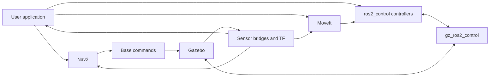
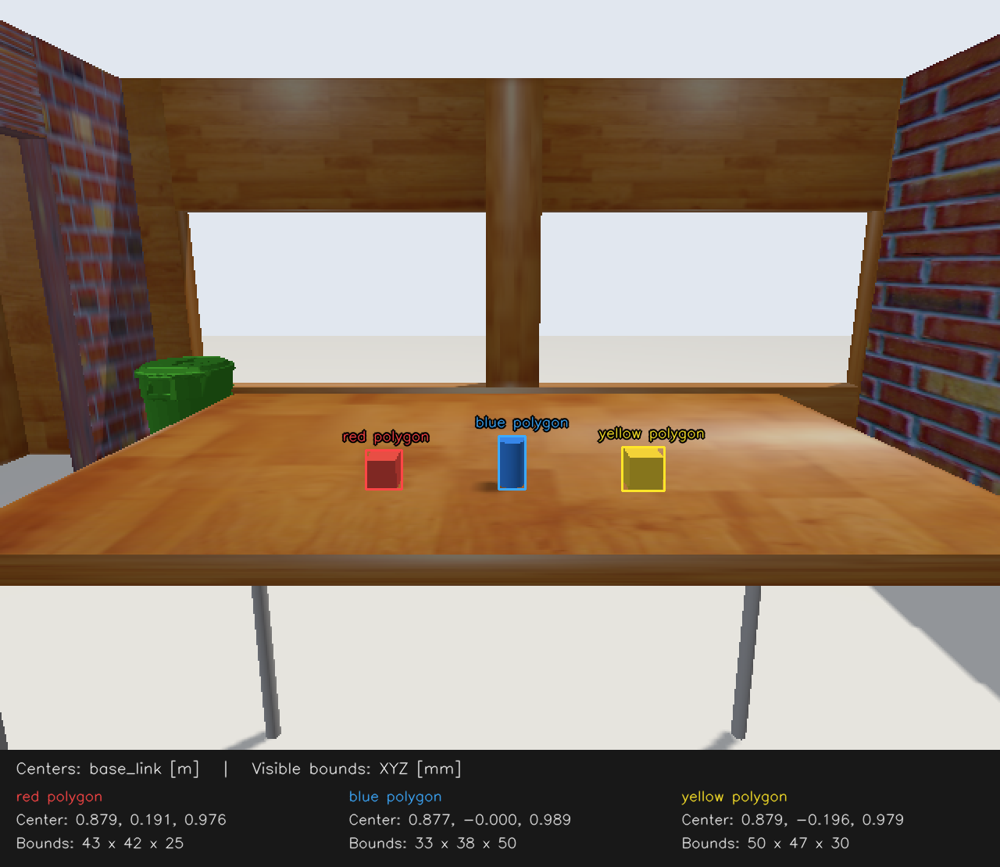

# Slide draft: from a Python experiment to a robot application

Working draft, 19 October 2026. This is a complete content draft for a simple deck,
following [TALK_SCRIPT.md](TALK_SCRIPT.md). Each numbered section is one slide.
Only the **On screen** section belongs on the slide. **Say** is suggested speech.
**Show / source** gives concrete media, terminal and evidence cues for production.
Code fences specify syntax highlighting. Keep code as text when building the deck.

The 38-slide sequence has not been timed in rehearsal. The allocation in the talk
script is a proposed 45-minute budget. Slides 22–23 are the first optional cut;
26–27 can also be omitted if needed. Prepare recordings of long robot motions.
A JSON result is evidence of a run, not an existing video. Media marked “capture”
needs recording before rehearsal. Preserve the operating conditions beside every
measurement. All shell commands below require this repository checkout.

---

## Slide 01: From a Python experiment to a robot application

**On screen**

From a Python experiment to a robot application

cppyy · cppyy_kit · ROS 2

Python defines the task. Native code handles selected operations.

**Say**

I usually work in robotics. That means autonomous systems, sensors, control, and
a lot of data. We are at ROSCon, so I suspect that sounds familiar. Today I want
to start with something quite small: a Python operation we want to change. Then
we will follow it into a robot application. We will call C++ libraries, process
ROS messages, implement a controller, and put those pieces together. The point
is to keep the experiment easy to change while still being clear about what is
running and what we have measured.

**Show / source**

Plain title slide. Use the robot scene from slide 02 as a still background only
if the text remains readable. Narrative source: [talk script](TALK_SCRIPT.md).

---

## Slide 02: Here is our playground

**On screen**

[Robot scene, arm motion and camera view]

A simulated TIAGo PRO in Gazebo

Find an object. Move it. Inspect the result.

**Say**

For today, I set up a simulated robot with some typical ROS 2 software. Here is
what it looks like. We have a mobile base, two arms, cameras, and some objects on
a table. We want the robot to find an object and move it. We will keep this same
robot as we change how we implement and connect its software. First I just want
you to recognise the scene. Later we will look at the cloud and image that the
application actually uses, and then at what happens when the gripper makes
contact with an object.

**Show / source**

Capture a short overview from the [source simulator](next_steps/tiago_pro_jazzy/README.md).
Include base motion, a separate arm motion and the camera view. Label the footage
“Gazebo simulation”. Do not present a navigation-enabled overview as the launch
configuration for every later demo. The existing
[perception overlay](next_steps/pick_place/evidence/perception_overlay.png) is a
camera-view fallback. Do not start the full pick-and-place sequence on this slide.

---

## Slide 03: Familiar robot software

**On screen**



Conceptual software diagram

**Say**

The software looks familiar too. There is a simulator, sensor and hardware
interfaces, controllers, navigation, motion planning, and our application on
top. On a real robot, hardware drivers occupy the boundary where we have
simulated hardware here. At any of these points, you might want to try a small
feature, replace a module, or build a whole new application. Today we will
experiment in Python, reuse C++ libraries, and move selected work into native
code when it helps. Keep this diagram in mind as we move between those layers.

**Show / source**

Render the Mermaid diagram. It describes roles, not process ownership or an
exact ROS graph. MoveIt and Nav2 are available playground components; several
custom demos disable them. Source: [talk opening](TALK_SCRIPT.md#1-set-the-scene).

---

## Slide 04: What do you reach for first?

**On screen**

Which language do you prefer when you need to get something working quickly?

Python · C++ · Rust

**Say**

Before we start, which language do you prefer when you need to get something
working quickly? Python? C++? Rust?

[Pause for hands.]

If Python wins: Good, I can spend less time defending the syntax and more time
showing what we can connect it to.

If C++ or Rust wins: Fair enough. Keep using it where it works for you. I want
to show why Python can still be useful for configuring, composing and exploring
those systems.

Python is a convenient orchestration language. We can write the task in it,
inspect intermediate values, and call code implemented elsewhere.

**Show / source**

Keep this to the short show of hands proposed in the
[talk script](TALK_SCRIPT.md#2-get-a-sense-of-the-room). Do not change the demo
configuration in response to the vote.

---

## Slide 05: A question to return to

**On screen**

Assistants can write integration code too.

What should we still understand, maintain and verify?

**Say**

One caveat I want to return to at the end: the way we write software is changing
quickly. Assistants can now generate a lot of the glue we used to write by hand.
I am excited about this kit, but its role may change too. Perhaps we will use it
directly less often and use it more as a tool for an assistant. Today I want to
show what it makes practical, and how we check it.

**Show / source**

Text only. This is the presenter's view and an open question. Keep this short,
as in [the script](TALK_SCRIPT.md#3-a-short-caveat-then-back-to-the-code).

---

## Slide 06: One operation is taking too long

**On screen**

```python
def sum_sq(x):
    total = 0.0
    for value in x:
        total += value * value
    return total
```

```text
Profile Python → choose an operation → write native implementation

Conventional extension:
C++ → bindings → build → import → try the change
```

Keep the experiment small.

**Say**

Start small. We have a Python function that works, but profiling says it is
taking too long. We know how we would write that operation in C++. One route is
a native extension: write the C++, expose it to Python, build it, make sure Python
can import it, and repeat when the implementation changes. That is a useful
deployment model. During a small experiment, I would like fewer steps between
changing the function and trying it again. Before adding another tool, though,
we should check whether a useful native implementation already exists.

**Show / source**

Use the workflow as a diagram. Do not stage a deliberately slow build or claim
that every extension edit requires manual reinstallation. CMake is one possible
build system. Exact Python loop: [python_sum.py](slide_assets/python_sum.py).
Source: [Python bottleneck section](TALK_SCRIPT.md#4-the-first-problem-one-python-operation-is-too-slow).

---

## Slide 07: Several useful routes

**On screen**

| Route | Useful starting point |
|---|---|
| NumPy / SciPy / existing bindings | An operation already exists |
| Numba | Supported numerical Python / NumPy loops |
| Cython | Typed Python-like source and native interfaces |
| pybind11 / extension | An explicit C++ API and build workflow |
| cppyy | Dynamic access to C++ APIs and templates |

**Say**

These solve different problems, and we can combine them. First I would check
NumPy, SciPy, or a library with bindings already available. An array expression
can remove a Python loop without adding a new C++ interface. Numba is useful
when the loop fits its supported numerical subset. Cython and a conventional
extension give us other ways to define the native boundary. What interests me
about cppyy is access to the C++ API while I am still working interactively in
Python. That includes code I write and libraries that already exist. We still
need to measure the operation we care about.

**Show / source**

Source links for the deck footer: [NumPy broadcasting](https://numpy.org/doc/stable/user/basics.broadcasting.html),
[Numba NumPy support](https://numba.readthedocs.io/en/stable/reference/numpysupported.html),
[Cython compilation](https://docs.cython.org/en/latest/src/userguide/source_files_and_compilation.html),
[pybind11](https://pybind11.readthedocs.io/en/stable/index.html),
[cppyy](https://cppyy.readthedocs.io/en/latest/). These describe scope, not a
performance ranking.

---

## Slide 08: First, plain cppyy

**On screen**

```python
import cppyy
import numpy as np

cppyy.cppdef("""
double sum_sq(const double* x, size_t n) {
    double sum = 0;
    for (size_t i = 0; i < n; ++i) sum += x[i] * x[i];
    return sum;
}
""")
x = np.array([1., 2., 3.], dtype=np.float64)
print(cppyy.gbl.sum_sq(x, x.size))
```

```text
14.0
```

**Say**

Here is the smallest example. Python supplies an array. We give cppyy a C++
function, then call that function through its Python proxy. The loop here is
C++. The call is ordinary Python syntax. That is already useful: I can try a
native operation without first writing a separate extension package. I chose a
sum of squares because we can see the whole function and check the answer.
NumPy already knows how to do this operation, so this slide is about the
interface, not a claim that this is the best way to sum an array.

**Show / source**

Use the complete code as a prepared terminal script. Expected output is `14.0`.
Code source: [talk script example](TALK_SCRIPT.md#5-from-cppyy-to-cppyy_kit).
Keep the same function and input on slide 09.

---

## Slide 09: The same function with cppyy_kit

**On screen**

```python
import numpy as np
from cppyy_kit import cpp
from cppyy_kit.numpy_types import NDArray

@cpp
def sum_sq(x: NDArray[np.float64]) -> float:
    """
    double sum = 0;
    for (size_t i = 0; i < x_size; ++i) sum += x[i] * x[i];
    return sum;
    """

print(sum_sq(np.array([1., 2., 3.], dtype=np.float64)))
```

```text
14.0
```

**Say**

With the kit, I put the C++ body in a docstring and describe the input in the
annotation. This is still C++ source. We are not translating the Python
function into C++. The annotation describes the buffer contract; the kit
supplies the entry point and the array size used by this loop. The function
then looks like a Python callable to the rest of the application. For a small
experiment, that keeps the native operation close to the Python code that uses
it. The result is the same fourteen we just checked.

**Show / source**

Prepared code and terminal output. Preserve the C++ docstring exactly.
Implementation: [cpp decorator](../cppyy_kit/_cpp.py).

---

## Slide 10: What the kit takes care of

**On screen**

```text
Python API and buffer contract
             ↓
Generated entry point + compiled artifact cache
             ↓
C++ function or existing C++ library
```

Headers · libraries · buffers · callbacks · ownership · shutdown

**Say**

cppyy gives us a lot. It also exposes integration details that matter in a
robot application: loading headers and libraries, startup work, buffers,
callback lifetimes, and shutting native objects down in the right order.
cppyy_kit started as reusable helpers for those details. The aim is to keep
experiments small without rediscovering the same integration failures. There
is still compilation on a cold path. On later runs we can load the compiled
function. cppyy can already load existing libraries and use precompiled
facilities. The contribution here is a convenient cache and integration
workflow for these examples.

**Show / source**

Use the diagram, then highlight the cache between the Python API and native
implementation. Sources: [kit caching guide](../docs/FREEZE.md),
[cppyy library loading](https://cppyy.readthedocs.io/en/latest/toplevel.html),
[cppyy startup](https://cppyy.readthedocs.io/en/latest/starting.html).

---

## Slide 11: Measure startup separately

**On screen**

New process → imports → compile or load → tiny call → exit

| Three-element call returns `14.0` | First process | Repeat median (3) |
|---|---:|---:|
| Python loop | 0.10 s | 0.07 s |
| cppyy, own standard PCH | 0.24 s | 0.24 s |
| cppyy_kit, auto-PCH + function cache | 0.54 s | 0.34 s |

Vanilla baseline: kit startup hook disabled. Fresh kit function cache.

**Say**

There are two different kinds of reuse here. cppyy already has a standard
precompiled header. Our kit can reuse a broader header set and the compiled
function. Plain cppyy still compiles this function each time. In a separate
phase measurement, defining and first calling it took about twelve milliseconds.
That is small compared with starting the interpreter and loading libraries.
For this example, the kit's extra loading work costs more than the compilation
it saves. So a cache is useful, but it does not guarantee a faster total startup
for every function. Next, let us separate that from the time spent in the loop.

**Show / source**

Measured on this workstation, 20 October 2026, Python 3.12.13, Linux x86-64.
[Corrected timings](slide_assets/timings.json),
[terminal output](slide_assets/terminal.txt),
and [phase/PCH audit](slide_assets/startup_audit.json).
The runner clears inherited PCH variables and disables the kit startup hook for
the baseline. Vanilla uses its existing standard PCH; the kit uses its existing
auto-PCH. Only the kit function cache starts empty. OS caches remain warm.
Process times include shutdown; `/usr/bin/time` resolution is 0.01 s.

Repository-root command:

```bash
pixi run python roscon_uk_2026/slide_assets/run_timings.py
```

The original 19 October baseline inherited the kit's PCH through its startup
hook. It is retained as [historical evidence](slide_assets/timings_shared_pch.json).
The audit records the actual PCH selected in each process. Explicit no-PCH
initialization fails in this installed cppyy backend; its exit and diagnostic
are recorded separately in the audit.

---

## Slide 12: Now bring in a real C++ library

**On screen**

A small joint step for a seven-joint arm

```cpp
#include <Eigen/Core>
#include <Eigen/Cholesky>

void joint_step(const double* jacobian, const double* delta,
                double damping, double* output) {
    using Jacobian = Eigen::Matrix<double, 6, 7, Eigen::RowMajor>;
    Eigen::Map<const Jacobian> J(jacobian);
    Eigen::Map<const Eigen::Matrix<double, 6, 1>> dx(delta);
    Eigen::Matrix<double, 6, 6> A = J * J.transpose();
    A.diagonal().array() += damping * damping;
    Eigen::Map<Eigen::Matrix<double, 7, 1>> dq(output);
    dq = J.transpose() * A.ldlt().solve(dx);
}
```

Python supplies `J` and `dx`. Eigen computes `dq`.

**Say**

Okay, summing three numbers is useful to see the syntax. Now let us give it
something closer to robotics. We have a Jacobian, a small change we want at the
hand, and we want a joint increment. Eigen already has the matrix operations
and the solver. This is the whole native operation. We map the NumPy buffers,
form the damped system and solve it. The interesting cost for this part of the
talk is bringing in Eigen and compiling this expression each time I restart
my Python program. That gives the cache something useful to save.

**Show / source**

Use [step.cpp](slide_assets/eigen_startup/step.cpp). The operation is
`dq = J.T @ solve(J @ J.T + damping² I, dx)`, with a 6-by-7 row-major Jacobian.
The [executable example](slide_assets/eigen_startup/demo.py) supplies fixed input
and checks the output against NumPy. Keep the code visible; point to the includes
and the `ldlt().solve` expression. This sets up the later admittance example.

---

## Slide 13: Keep the code. Reuse the compiled function.

**On screen**

Vanilla cppyy:

```python
import cppyy
cppyy.add_include_path(include)
cppyy.cppdef(source)
```

cppyy_kit:

```python
from cppyy_kit import cppyy, cppdef_cached
cppdef_cached(
    source,
    decls='void joint_step(const double*, const double*, double, double*);',
    include_paths=[include],
    name='slide_joint_step',
)
```

Same call:

```python
cppyy.gbl.joint_step(J, dx, 0.05, dq)
```

**Say**

Here is the change on the Python side. Both versions get exactly the same C++
source. With plain cppyy, we compile it in this process. With the kit, we also
give it the function declaration. That lets it separate the small interface
Python needs from the Eigen implementation. The first run prepares a shared
library. The next process loads that library and exposes the declaration.
I still have the same Python call, and I have not added a CMake project or
written a binding module. That is a concrete bit of work the kit handles for us.

**Show / source**

`source` is the text of `step.cpp`; `include` is the environment's `include/eigen3`
directory. These are the two branches of [demo.py](slide_assets/eigen_startup/demo.py).
Show `cache.reason: miss-built` on the first kit run and `cache.cached: true` on
the next. The full runner records the selected PCH and verifies every result.

---

## Slide 14: Now the cache has work to save

**On screen**

Same Eigen operation · fresh Python process each time

| Prepared path | Whole-process median, 3 launches |
|---|---:|
| Vanilla cppyy + its standard PCH | 1.695 s |
| Same code + prepared Eigen PCH | 1.512 s |
| cppyy_kit + compiled function cache | **0.319 s** |

**5.3× faster repeat startup** with the function cache.

First kit cache-building run: **3.948 s**.
Separate Eigen PCH preparation: **1.743 s**.

**Say**

Now there is a difference we can point to. Plain cppyy takes about one point
seven seconds to start, compile, calculate and check the result. With the
compiled function ready, the kit takes about point three two seconds.
The first kit run costs more, about four seconds, because it prepares that
library. We pay that once for this cached implementation and reuse it when we
restart. I also measured a precompiled Eigen header separately. That helps a
little here, but it still leaves the expression and solver to compile. Most
of this example's saving comes from keeping the compiled function. So we have
two useful tools: reuse parsed headers, and reuse compiled implementations.

**Show / source**

Run from the repository root:

```bash
pixi run python roscon_uk_2026/slide_assets/eigen_startup/benchmark.py
```

Recorded whole-process samples, rounded from [results.json](slide_assets/eigen_startup/results.json):

```text
vanilla cppyy:       1.689  1.704  1.695 s
prepared Eigen PCH:  1.512  1.511  1.554 s
kit function cache:  0.330  0.315  0.319 s
```

Use [terminal.txt](slide_assets/eigen_startup/terminal.txt) for actual terminal
output and [the run guide](slide_assets/eigen_startup/README.md) for individual
stage commands. All paths run the same C++ source and fixed arrays and check
against NumPy; maximum absolute error is below `2e-16`. The kit startup hook is
disabled, and inherited PCH settings are removed. Baseline and function-cache
runs use cppyy's own existing standard PCH. The Eigen-PCH path explicitly
selects its separate artifact. OS caches remain warm. Process timing includes
input preparation, validation and shutdown. Highlight the one-time cost as well
as the repeated-launch saving. Then return to warmed computation on the next slide.

---

## Slide 15: Then measure the operation

**On screen**

One million float64 values · same input · same result

| Warmed call median (7 calls) | Time |
|---|---:|
| Python loop | 52.136 ms |
| cppyy | 0.447 ms |
| cppyy_kit | 0.418 ms |

```text
result: 3283500000.0
```

Startup time ≠ warmed execution time ≠ robot response time

**Say**

Now ask a different question: once the function is ready, how long does the
operation take? We use a million values and repeat the same sum-of-squares
loop. Each input value is an integer from zero to ninety-nine, stored as a
double. All three implementations return the same result. The Python loop
median is about 52 milliseconds. Both native versions take about
four tenths of a millisecond. cppyy supplies the native execution in both
cases. The kit gives us a smaller authoring interface and a compiled-function
cache. A vectorised NumPy operation is another useful solution here. This
measurement isolates the loop; it does not include ROS transport or a robot task.

**Show / source**

Measured on the same workstation as slide 11, sequentially. Each script prepares
its input and makes an initial call before seven measured calls.
Evidence: [timings.json](slide_assets/timings.json), `throughput`.
Both native versions operate on the same NumPy buffer layout as the Python loop.
Show all three bars with numeric labels. Do not imply the small cppyy-versus-kit
difference establishes a general speed advantage.

Runnable repository-root command:

```bash
pixi run python roscon_uk_2026/slide_assets/kit_sum.py
```

Selected fields from actual stdout:

```json
{"elements": 1000000, "result": 3283500000.0, "median_ms": 0.416039}
```

The complete output also includes all seven raw samples. Equivalent scripts:
[python_sum.py](slide_assets/python_sum.py),
[cppyy_sum.py](slide_assets/cppyy_sum.py), [kit_sum.py](slide_assets/kit_sum.py).
Operation comparison on a recorded robot cloud follows on slide 20.

---

## Slide 16: Bring ROS into the story

**On screen**

```text
rclcppyy     rclpy-style interface, backed by C++ ROS machinery
rclcpp_kit   Direct rclcpp objects and C++ messages
```

```text
ROS input → C++ message → native operation → ROS output
                  ↑
       Python configures and orchestrates
```

**Say**

Our data now comes from ROS. If the next operation expects a C++ ROS message,
it is useful to keep that message as a C++ object while Python decides what to
do with it. rclcppyy provides an rclpy-style interface backed by the C++ ROS
machinery. Underneath, rclcpp_kit lets us work directly with rclcpp objects and
C++ messages. The demonstrations here use that lower-level kit directly. The
important boundary is the message representation: we can keep the native
object rather than rebuild all its fields as Python data before calling the
next native operation.

**Show / source**

Use the naming from [rclcpp_kit](../rclcpp_kit/README.md) and its linked
[rclcppyy project](https://github.com/awesomebytes/rclcppyy). Keep native-stage
examples labelled `rclcpp_kit`.

---

## Slide 17: Python can inspect a C++ ROS object

**On screen**

```python
import rclcpp_kit
rclcpp = rclcpp_kit.bringup_rclcpp()

from rclcpp_kit import tf
listener = tf.TransformListener()
ts = listener.lookup_transform("world", "sensor", timeout=1.0)
x = ts.transform.translation.x
```

`ts` refers to a C++ geometry message.

**Say**

Here is a small example before we open the perception pipeline. A C++ TF
listener receives transforms. Python asks for a transform and inspects its
translation using familiar attribute access. The result is a proxy to the C++
geometry message. That is useful when we want to inspect a value in Python
and then pass a compatible native object to another native operation. If the
callback does not need Python at all, we can keep that callback native too.
The kit has managed sessions for the longer pipelines so their executors and
native resources have an explicit owner.

**Show / source**

Exact API excerpt from [rclcpp_kit README](../rclcpp_kit/README.md).
For a live terminal, run the repository TF demo, which supplies its own matching
frame setup:

```bash
pixi run -e rclcpp demo-tf-lookup
```

The shown standalone lookup assumes the named frames have been published. Do
not fabricate a transform value as output.

---

## Slide 18: Be precise about copies

**On screen**

| Boundary | What happens here |
|---|---|
| Existing compatible C++ object → proxy | No Python-message reconstruction |
| Python-message compatibility adapter | Conversion may be required |
| Middleware transport | Depends on transport and configuration |
| Cloud transform / PCL filtering | Allocations and copies remain |
| Compatible image buffer → view | Retain its owner; outputs can allocate |

Fewer representation changes at specified boundaries.

**Say**

I want to be specific about this claim. A proxy to an existing compatible C++
object avoids a separate Python-message conversion on that direct path. A
compatibility adapter that accepts Python messages can still need conversion.
The middleware has its own transport behaviour. And our cloud processing
still transforms points, converts to PCL, and allocates filtered outputs. A
compatible image buffer can be viewed without rebuilding its pixels, provided
its owner stays alive. That does not mean the image algorithm allocates
nothing. These are useful boundaries to improve and measure individually.

**Show / source**

Keep the complete table legible. Source:
[native pipeline and deployment](next_steps/pick_place/DEPLOYMENT.md).
Point to the cloud row again when discussing composition on slide 35.

---

## Slide 19: Give the cloud operation a job

**On screen**

```text
Cloud → finite points + ROI → voxel centroids
      → table plane → object clusters
```

```cpp
pcl::VoxelGrid<pcl::PointXYZ> voxel;
voxel.setInputCloud(roi);
voxel.setLeafSize(c.leaf, c.leaf, c.leaf);
voxel.filter(*down);
```

**Say**

Now we can give this a useful job. Reduce the point cloud, remove the table,
and group the remaining points. Here is the native voxel filter inside the
cloud stage. We set a grid size and ask PCL to produce a centroid for each
occupied voxel. The rest of this stage finds the tabletop and extracts
clusters above it. Python supplies configuration and receives the result. I
want to see those intermediate outputs before asking the robot to move. If I
change the voxel size, do I still have enough detail to distinguish the
objects, and does the selected cluster still make sense?

**Show / source**

Code excerpt: [cloud.cpp](next_steps/pick_place/native/cloud.cpp).
Show the recorded cloud and intermediate objects beside the code. Capture the
live native-stage outputs, or run the recorded fallback from the `pick_place`
directory:

```bash
pixi run --manifest-path ../../../pixi.toml -e pick-place replay-pick-place
```

Source and result owner: [perception.py](next_steps/pick_place/perception.py).
Keep recorded cloud coordinates labelled `base_link`; live pipeline outputs
are transformed into `odom`.

---

## Slide 20: Compare the same voxel operation

**On screen**

| Same recorded input, 8 mm grid | Median |
|---|---:|
| NumPy | 15.34 ms |
| PCL, including boundary copies | 1.31 ms |

49,695 input points → 9,181 centroids in both implementations

Maximum centroid difference: 2.38 × 10⁻⁷ m

**Say**

This is the numerical comparison I promised. Both implementations receive the
same finite points from the recorded region of interest and use an eight
millimetre grid. Both return 9,181 centroids. The maximum difference between
matched centroids is about two times ten to the minus seven metres. On this
recorded measurement, the NumPy median is 15.34 milliseconds and PCL is 1.31
milliseconds, including the copies at the PCL boundary. That is a useful
improvement for this operation. It does not tell us that every PCL operation,
every image operation, or the whole ROS application improves by that amount.

**Show / source**

Use a two-bar chart with a zero origin, units in ms and values printed on bars.
Evidence: [replay_evidence.json](next_steps/pick_place/replay_evidence.json),
`voxel_comparison`. Source fixture: `next_steps/pick_place/sample.npz`.
Keep this measurement separate from `native_loading_and_first_calls_ms` and the
full cloud stage. Do not label these numbers end-to-end ROS latency.

---

## Slide 21: Use the image to select the object

**On screen**



```python
def image(self, image, encoding="rgb8", min_area=40):
    if encoding not in ("rgb8", "bgr8"):
        raise ValueError("encoding must be rgb8 or bgr8")
    native = load_image()
    import cv_kit
    if not hasattr(image, "__cpp_name__"):
        image = cv_kit.numpy_to_mat(image)
    return native.process_image(image, encoding == "rgb8", min_area)
```

**Say**

The cloud gives us geometry. The image helps select the coloured object we
want. This is the method the Python application calls. It can accept an array
or an existing native matrix, then call the same native image stage. The stage
uses OpenCV colour masks and contours. We associate those regions with cloud
clusters using the camera calibration and transforms. A red patch in the image
alone is not a grasp target. The overlay lets us inspect the association.
This example shows library integration and data handling. OpenCV's existing
Python bindings already call native algorithms.

**Show / source**

Use the existing [perception_overlay.png](next_steps/pick_place/evidence/perception_overlay.png).
Code is the method body from [perception.py](next_steps/pick_place/perception.py),
with its docstring omitted for slide space. Native implementation:
[image.cpp](next_steps/pick_place/native/image.cpp). If image space competes with
code, use a build: image first, then code over a dimmed image. The labels denote
colour and 2D silhouette; they are not learned semantic classes.

---

## Slide 22: Optional: another native library

**On screen**

Find nearby observations from other frames.

```python
from index import Index

with Index([[0., 0., 0.], [.2, 0., 0.]],
           [0, 20], [1., .8]) as index:
    result = index.query([[0., 0., 0.]], [0], k=2,
                         frame_gap=2, min_confidence=.5,
                         max_distance=.5)
    print(result["ids"])
    print(result["centroids"])
```

```text
[[1, -1]]
[[0.2, 0.0, 0.0]]
```

**Say**

What if the operation I need is not in the Python interface I already have?
Here is a native spatial index with a selection rule specific to the data. I
want nearby observations, but I exclude adjacent frames and require a minimum
confidence. The first point is at the query position, but it comes from the
same frame, so it is excluded. The second qualifies. The index stays alive
across query batches. Construction copies the input into retained native
storage. We use a context manager to make the index's lifetime explicit.

**Show / source**

Exact small query from [nanoflann README](next_steps/nanoflann/README.md).
Run from its prepared directory, where `index.py` is importable. This two-point
snippet differs from the four-point `pixi run demo` fixture, whose accepted ID
is 2. The example uses synthetic observations. Do not claim this is a recorded
robot dataset or that no nanoflann Python wrapper exists elsewhere.

---

## Slide 23: Optional: keep the selection in the search

**On screen**

```cpp
bool addPoint(double squared, std::size_t id) {
    if (squared > radius_squared || cloud.confidence[id] < min_confidence)
        return true;
    if (gap >= 0 && std::abs(cloud.frames[id] - frame) <= gap)
        return true;
    const auto candidate = std::make_pair(squared, id);
    const auto where = std::lower_bound(best.begin(), best.end(), candidate);
    if (best.size() < capacity || where != best.end()) {
        best.insert(where, candidate);
        if (best.size() > capacity) best.pop_back();
    }
    return true;
}
```

nanoflann traverses the index. Our result set selects eligible observations.

**Say**

Here is the native rule. Rejecting an ineligible observation during the search
lets the search continue to a more distant eligible one. If we simply asked for
the nearest two and filtered those two afterwards, we could miss a valid
observation farther away. nanoflann supplies the index and traversal. This
small result set supplies our frame, confidence and distance conditions, and
orders selected results by squared distance and original index. That is the
sort of library-specific operation I want to try without maintaining a
separate extension package for each experiment.

**Show / source**

Exact `Selection::addPoint` from [native.cpp](next_steps/nanoflann/native.cpp).
The wrapper is [index.py](next_steps/nanoflann/index.py). Retain the squared-distance
label. Returned arrays own their storage; the native tree retains its own
copied input. Skip slides 19–20 together if the main sequence needs more time.

---

## Slide 24: Let a native framework call Python

**On screen**

```python
class GentleServo:
    def configure(self, joints, options):
        self.speed = options.get("speed", 0.2)  # rad/s

    def activate(self, measured):
        self.target = list(measured)

    def set_target(self, positions):
        self.target = list(positions)

    def update(self, measured, dt):
        step = self.speed * dt
        return [
            q + max(-step, min(step, goal - q))
            for q, goal in zip(measured, self.target)
        ]
```

Controller-specific Python · reduced teaching example

**Say**

So far we have called native functions. Now let us implement behaviour that a
native framework calls. Here is a Python controller for a ros2_control bridge.
On activation it holds the measured state. A target changes where it wants to
go. Each update returns a bounded increment towards that target. This is all
the controller-specific code in the teaching example. control_kit supplies the
reusable bridge into the real controller manager. For the actual robot demo we
use the validated PositionServo, which also handles target validation and joint
limits. I will show the bridge next so we can see where this short class fits.

**Show / source**

Exact teaching code from [speaker notes](SPEAKER_NOTES.md#one-slide-the-controller-specific-python).
Use a large code font and reveal `update` last. The increment is bounded relative
to feedback; it does not guarantee physical speed. Live/recorded controller:
[PositionServo](../control_kit/demos/python_position_controller.py), run using the
[Gazebo Python controller guide](next_steps/pick_place/README.md#python-controller-inside-gazebo).
Do not replace the validated class with this teaching class on stage.

---

## Slide 25: Here is the reusable glue

**On screen**

```yaml
gentle:
  ros__parameters:
    type: control_kit_python/PythonController
    joints: [joint1, joint2]
    python_path: /absolute/path/to/controllers
    python_module: gentle_servo
    python_class: GentleServo
    python_options: '{"speed": 0.2}'
```

```python
from control_kit.python_control import install_python_controller_plugin
install_python_controller_plugin("/absolute/path/to/overlay")
```

```cpp
auto result = checked(PyObject_CallMethod(controller_, "update", "Od", values.get(), dt));
```

**Say**

The configuration selects a module, a class, and the joints it controls. The
export helper builds or reuses one bridge and writes the plugin metadata. The
controller manager discovers that plugin through its overlay. Here is the
actual C++ call into Python during update. The bridge acquires the GIL, passes
feedback and the period, checks the returned positions, and writes the command
interfaces. CPython makes embedding possible. control_kit supplies that bridge.
cppyy_kit builds and caches it. A conventional ROS package could provide the
same Python API; this example reduces the build and integration work we maintain.

**Show / source**

Use sequential builds: configuration, export, then the C++ call. YAML names and
paths are illustrative, as in [speaker notes](SPEAKER_NOTES.md#next-slide-show-the-glue).
Real invocation: [python_controller.cpp](../control_kit/control_kit/python_controller.cpp:240).
Export: [python_control.py](../control_kit/control_kit/python_control.py:55).
The manager must inherit the overlay through `AMENT_PREFIX_PATH` before startup;
stock interface owners must be switched out. Show a prepared wrist-motion clip
from the validated servo. Python executes inside Gazebo's manager with the GIL;
this is not hard real-time.

---

## Slide 26: Optional: the same pattern in Nav2

**On screen**

```python
def prepare(self, yaw, path_heading, goal_distance):
    self.yaw = yaw
    self.path_heading = path_heading
    self.near_goal = goal_distance <= self.goal_tolerance
```

```python
translating = math.hypot(vx, vy) > self.translation_epsilon
if translating:
    if abs(math.atan2(vy, vx)) > self.camera_half_angle:
        return None
```

DWB critic: cost or rejection for a candidate trajectory

**Say**

We did this for ros2_control. Now a small Python class changes how Nav2 scores
candidate trajectories. This is a DWB critic, a smaller interface inside the
existing controller. Once per controller cycle, the policy receives the robot
yaw, path heading and distance to the goal. For each candidate it can return a
cost or reject the candidate. This part rejects translation outside the
forward camera cone. The complete policy also scores predicted heading and
allows final-yaw handling near the goal. The kit supplies the framework glue,
while Nav2 keeps its trajectory generator and configured collision checks.

**Show / source**

Exact `prepare` and selected `score` lines from
[ForwardCameraPolicy](../nav2_kit/demos/forward_camera_policy.py). The second block
is an excerpt within `score`, not a complete function. The policy assumes the
head camera faces forward relative to the base. This uses the GIL. Keep beside
slide 25 so the repeated integration pattern is visible.

---

## Slide 27: Optional: inspect the navigation result

**On screen**

| Same goal, same initial pose | Original | Forward profile |
|---|---:|---:|
| Translation commands outside ±30° | 77 / 112 | 0 / 113 |
| Measured distance outside cone | 0.562 m | 0.00592 m |

Both runs reached the Nav2 goal.

Forward profile also changes footprint checks and velocity samples.

**Say**

Here is what happened in the recorded comparison. The robot started facing
north and received a goal eight tenths of a metre east. Both profiles reached
the goal. With the forward profile, none of the counted translation commands
went outside the thirty-degree cone. The measured motion still had a small
amount outside it. A velocity constraint and physical motion are different
things. This compares complete profiles: the forward profile also adds
footprint checking and changes velocity samples. Depth is a separate opt-in
costmap source. Turning towards a camera does not automatically make its depth
stream affect navigation.

**Show / source**

Capture the original and forward runs with robot heading and path visible.
Existing evidence, not existing video:
[navigation guide](next_steps/navigation/README.md),
[baseline.json](next_steps/navigation/evidence/baseline.json),
[forward.json](next_steps/navigation/evidence/forward.json).
Counts include commands above 0.03 m/s; pose increments below 0.1 mm are discarded.
The forward endpoint was 0.09775 m from the goal, within its 0.1 m tolerance.
For setup, use the navigation guide's source-checkout launch with
`TIAGO_PRO_NAV_PROFILE=forward`; depth is independently enabled by
`TIAGO_PRO_NAV_DEPTH=1`. Recovery behaviours are separate from this critic.

---

## Slide 28: A more useful Python control law

**On screen**

Virtual-force admittance

```text
mass × acceleration + damping × velocity + stiffness × offset = force
```

```python
acceleration = (force - self.damping*self.velocity - self.stiffness*self.offset) / self.mass
self.velocity += h * acceleration
self._bound(self.velocity, self.max_cartesian_speed)
self.offset += h * self.velocity
```

```python
command = self.chain.step(q, self.target, self.lower, self.upper, dt,
                          self.tracking_gain, self.damping_lambda, self.joint_speed)
```

Python behaviour → one native kinematics call

**Say**

Now keep the mass, spring and damper behaviour in Python, and make one native
call for forward kinematics, the Jacobian and a joint-motion solve. These are
lines from the actual update. The integration uses small substeps, bounds the
reference motion, and expires stale force commands. The native step calculates
joint commands for the target pose. The spring behaviour is Python. The
kinematics calculation is C++. We can change the behaviour without making
another C++ controller plugin. We compile and warm the native functions before
activation, so that work is already done when we start moving.

**Show / source**

Exact update excerpts from
[CartesianAdmittance](../control_kit/demos/python_admittance_controller.py).
The full update includes force expiry and displacement bounds between the shown
blocks. Native Eigen implementation:
[arm_kinematics.hpp](../control_kit/demos/arm_kinematics.hpp).
Wrapper: [arm_kinematics.py](../control_kit/demos/arm_kinematics.py).
Use a build to distinguish the Python law from the single native call.

---

## Slide 29: Hold to push. Release to return.

**On screen**

[Browser controls beside the robot hand]

Synthetic +X force: 1 N in `torso_lift_link`

| Recorded run | Result |
|---|---:|
| Peak measured displacement | 10.86 mm |
| Position error after release | 1.45 mm |
| Python updates inside Gazebo | 1,157 |

**Say**

Hold a browser button to apply a virtual force. Release it and the hand returns
towards its starting pose. I will use one newton along X. The stiffness is
eighty newtons per metre, so that requests a twelve-and-a-half millimetre
equilibrium offset. The recorded run moved 10.86 millimetres and returned
within 1.45 millimetres. The force here is synthetic. It is not a wrist-sensor
reading or a physical wrench applied to Gazebo. This is a local arm compliance
example. Watch the release as well as the push, because returning and restoring
the stock controller are part of the demonstration.

**Show / source**

Prepare and warm before presenting. Follow [ADMITTANCE.md](next_steps/pick_place/ADMITTANCE.md)
for the simulator's `kit` environment and plugin overlay. From `pick_place`:

```bash
pixi run --manifest-path ../../../pixi.toml -e pick-place demo-control-admittance --interactive
```

Open the printed localhost URL. Show +X hold, release and return. Enter or
Ctrl-C in the demo terminal permits return, restores the stock controller and
unloads the demo. Evidence: [live.json](next_steps/pick_place/evidence/admittance/live.json).
If live motion is unavailable, label the recording as a previous run. The small
controller has no collision avoidance; keep this operating condition in notes
and avoid introducing obstacles during the demonstration.

---

## Slide 30: Assemble the robot task

**On screen**

```text
Perception → selected object → approach → descend
          → close → verify lift → transfer
          → release → retreat → verify placement
```

Each stage waits for feedback.

Existing trajectory controllers execute the validated application.

**Say**

We now have perception, a selected object and ways to command motion. A
pick-and-place application coordinates them: approach, reach, close the
gripper, lift, move, release and retreat. Each stage needs feedback before the
next stage starts. A successful gripper action response alone does not prove
that we have grasped an object. We need to observe the object lifting and
check where it ends up after release. The validated application uses the
existing trajectory controllers. The new Python servo and admittance
controller are separate demonstrations. Now we will look at the task sequence
that connects those measured stages.

**Show / source**

Diagram above a still of the selected red object. Sources:
[manipulation.py](next_steps/pick_place/manipulation.py),
[application guide](next_steps/pick_place/README.md).
Use a prepared recording for the full sequence. The measured Placo waypoint
motion alone took 116.1 s, excluding startup and gripper waits.

---

## Slide 31: The sequence is ordinary Python

**On screen**

```python
self._gripper(side, c.open_position, "open")
self._move(side, approach, down, "approach")
self._move(side, grasp, down, "descend")
self._gripper(side, c.close_position, "close")
self._move(side, lifted, down, "lift")
raised = self._observe(name)
self.result.measurements["contact_lift_m"] = float(raised[2]-baseline[2])
```

```python
final = self._observe(name)
distance = float(np.linalg.norm(final-destination))
self.result.measurements["placement_error_m"] = distance
if distance > c.placement_tolerance:
    raise RuntimeError("Released object is outside the placement tolerance")
```

**Say**

Here is part of the actual sequence. The calls read like the task: open,
approach, descend, close, lift. The move callback waits for measured position
and orientation convergence. After the lift, we observe the object again and
record how far it moved. After release and retreat, we measure its distance
from the requested destination. The full code stops when a stage fails. That
means the application result says something about the observed task, rather
than only saying that a list of commands was sent. Python is doing what it is
useful for here: expressing and inspecting the sequence.

**Show / source**

Exact separated excerpts from [manipulation.py](next_steps/pick_place/manipulation.py).
Use the complete function in the editor if someone asks about failure handling.
For the contact run shown next, attachment assistance is disabled. Do not hide
a simulated attachment result behind a generic “grasp succeeded” label.

---

## Slide 32: Add whole-body task goals

**On screen**

```python
controller.set_goal('gripper_left_grasping_link',
                    position=(-2.85, 2.23, 1.20))
controller.set_goal('gripper_right_grasping_link',
                    orientation=(0., 0., 0., 1.))
controller.set_elbow_goal('left', (-2.95, 1.8, 1.0), weight=.03)
controller.look_at((-2.85, 2.23, 1.05))

command = controller.step(measured_joint_positions,
                          measured_base_xy_yaw, dt=.05)
robot.command(command, duration=.05)
```

Positions: `odom`, m · orientations: XYZW quaternions

**Say**

An arm target becomes more useful when I can also express posture, gaze,
orientation and how much I want the torso or base to move. Here we ask for a
left-hand position, a right-hand orientation, a softer elbow goal, and a gaze
target. Those are different task choices we can change from Python. The
controller uses measured joint and base state to calculate the next command.
The default motion costs favour arm motion before torso and base motion.
Those are weighted preferences, not a strict priority hierarchy. The base
being available to the solver does not mean every grasp needs the base to move.

**Show / source**

Exact task API calls from [README WBC examples](next_steps/pick_place/README.md#change-whole-body-tasks-from-python),
with line wrapping and the optional obstacle setup omitted. Controller setup
requires a URDF and measured state as shown in that guide. Capture separate
position, orientation, elbow and gaze goal changes if available. Do not claim
those task changes all occur in the final grasp recording.

---

## Slide 33: Reuse a solver when it fits

**On screen**

```python
from placo_controller import PlacoWholeBodyController as WholeBodyController

controller = WholeBodyController(urdf_text)
```

Same task API → Placo's existing Python bindings → native solver

WBC runs outside the ros2_control update loop.

**Say**

We explored a small custom implementation and also integrated Placo. If an
existing solver gives us the behaviour we need, we should use it. This changes
the backend while keeping the task interface useful to the application. Placo
already has Python bindings, so we use those. cppyy_kit still handles the
native perception integration elsewhere in the application. The whole-body
controller runs outside the ros2_control update loop and sends commands to the
existing controllers. The separate Python plugin example did not move this
solver into that loop. Python remains the place where we express and change
the task.

**Show / source**

Use the backend import substitution from
[WBC guide](next_steps/pick_place/README.md#change-whole-body-tasks-from-python).
The custom and Placo backends have different collision capabilities. Placo's
full-robot self-collision constraints are enabled in the recorded run. Describe
local, discrete command checks accurately; do not label this a global motion
planner or continuous collision proof. Solver reference:
[Placo kinematics](https://placo.readthedocs.io/en/latest/kinematics/getting_started.html).

---

## Slide 34: The recorded contact result

**On screen**

[Pick, lift, transfer, release and retreat recording]

Placo contact run · Gazebo simulation

84.8 mm object lift · 16.8 mm placement error

Physical contact · no attachment assist · one successful run

**Say**

Now use those task goals for the same pick-and-place sequence. Watch the
object, not just the arm. It lifts after the fingers close, moves with the
hand, and remains at the placement location after release and retreat. In this
recorded Placo run the measured lift was 84.8 millimetres and placement error
was 16.8 millimetres. Attachment assistance was disabled. This is one successful
run, so it tells us that this task completed under these conditions. It is not
a success-rate measurement. The useful result is that the perception,
controller and task sequence produced an observed contact pick and place.

**Show / source**

Capture or select footage matching
[runs/placo-contact.json](next_steps/pick_place/runs/placo-contact.json).
If that exact recording is unavailable, show the JSON-derived result with a
clearly labelled illustrative robot still. Do not present footage from a
different assisted run as this result. Retain the “one successful run” caption.
Evidence discussion: [RESULTS.md](next_steps/pick_place/RESULTS.md#placo-controller).
Do not append an unvalidated handover demonstration.

---

## Slide 35: Keep the algorithms. Change the deployment.

**On screen**

```text
Separate processes:
[Filter] → [Cluster] → [Task]
[Image] ─────────────→ [Task]

Composed application process:
[Filter → Cluster | Image | Task]

Gazebo remains a separate process in both cases.
```

Same native stages and ROS interfaces

**Say**

We first kept the stages in separate processes because it is easy to inspect
their interfaces. Now keep the algorithms and compose the native stages in one
application process, configured from Python. The task can still observe their
ROS outputs. The filter-to-cluster path uses rclcpp intra-process delivery
when composed. That can avoid some transport work, but the transform, PCL
conversion and filtering still allocate or copy data. We did a live comparison
of these deployments. It did not establish a latency speedup. What this gives
us is a way to investigate deployment costs without rewriting perception.

**Show / source**

Render the process boxes with distinct borders. Do not draw Gazebo inside the
composed box. Source: [DEPLOYMENT.md](next_steps/pick_place/DEPLOYMENT.md).
Measured comparison: [live_summary.json](next_steps/pick_place/evidence/composition/live_summary.json).
Runs received different inputs and observer scheduling affected latency.
Use the results guide if detailed CPU or arrival measurements come up.

---

## Slide 36: Compose it from Python

**On screen**

```python
from pipeline import PerceptionPipeline

with PerceptionPipeline(prefix="/pick_place") as perception:
    run_task_controller()
```

Repository root:

```bash
pixi run -e pick-place python roscon_uk_2026/next_steps/pick_place/demo.py \
  --deployment composed --observe
```

Expected: selected coloured object, measured centre and bounds in `odom`.

**Say**

This is the composition surface. A context manager owns the perception
pipeline while the task runs. The task-controller call here stands for our
application. In the actual command, observe mode selects an object without
commanding robot motion. We can change the deployment argument to run the same
stages in separate processes. That is useful while developing: first inspect
the message boundaries, then investigate which process arrangement makes
sense for this application. The algorithms and the task do not have to be
rewritten to make that comparison.

**Show / source**

Code pattern and executable command from
[DEPLOYMENT.md](next_steps/pick_place/DEPLOYMENT.md). The pattern assumes the
`pick_place` directory is on `sys.path`; `run_task_controller` denotes the
application, not an exported kit function. Use the full command for a runnable
terminal. Change `composed` to `distributed` to select three native-stage
processes. The simulator must already be running. Show actual output if live;
use the expected-result description rather than inventing exact coordinates.

---

## Slide 37: Ownership is part of the application

**On screen**

```text
Busy worker → one current input + at most one pending input
New input   → replaces pending work
Shutdown    → cancel executor → join executor → join workers
            → release TF listener and buffer
```

Bound pending work. Retain owners. Join before releasing dependencies.

**Say**

Putting things in one process also makes ownership and shutdown more visible.
Each native stage owns its current input and keeps at most one pending input.
When it is busy, a newer input replaces pending work. That bounds the backlog
for this live perception task. On shutdown, we stop and join the executor,
join the stage workers, and only then release the transform resources they
can access. These details matter to the person changing the experiment. A
short Python application is more useful when the reusable integration code
also gives it a predictable lifetime.

**Show / source**

Use a simple queue animation, then the shutdown sequence. Contract and ordering:
[DEPLOYMENT.md](next_steps/pick_place/DEPLOYMENT.md).
The saved live composition evidence records joined shutdown for each process.
Avoid implying that latest-input replacement is the correct policy for every
ROS workload. Here it is an explicit live-perception choice.

---

## Slide 38: What should we make easier to change?

**On screen**

```text
Python operation → native library → ROS data
                 → framework behaviour → robot task
```

How much code must we understand, maintain and verify?

Questions

**Say**

We started with a small Python operation, reused native libraries, processed
ROS data, implemented a controller, and assembled a robot task. If an assistant
can generate the wrappers and build files, what is still useful about a kit
like this? For me, the question is how much code we must understand, maintain
and verify to get from an idea to a working experiment. Reusable integration
code can help a person or an assistant. We should keep measuring that benefit
as the tools change. I would like to hear where this would help in your robot
software, and which boundary you would want to inspect first.

**Show / source**

Return to the robot still from slide 02, with the route through the software
stack highlighted. Link the project repository and talk material in the final
deck using the repository's established URL. Narrative source:
[talk closing](TALK_SCRIPT.md#closing-return-to-the-changing-role-of-tooling).
The robot runs do not measure assistant productivity. Keep the ending as a
question and discussion, with no additional live demo.
