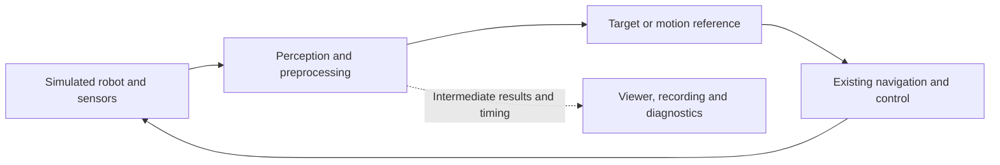

# One robot playground, several ways to build its software

Rough narrative for the 45-minute ROSCon UK 2026 deep dive. This captures the
new direction discussed for the talk. It is not an implemented robot stack or
a replacement for the existing [presentation plan](PLAN.md) and its evidence.

## The shared setting

Start with a simulated mobile manipulator: a wheeled base, arm(s), RGB/depth,
IMU, joint state and range/point-cloud data. The selected starting robot is
[Stretch 4 in its official MuJoCo simulator](next_steps/robot_playground/README.md).
Local locked Pixi checks verified base, lift and arm motion, RGB/depth, IMU and
two 3D lidar streams. The user confirmed the interactive viewer and cameras.
Stretch 3 is a verified fallback. A separate upstream Jazzy ROS bridge probe
passes base commands, clock, joint state, IMU, odometry, scan, point clouds and
head images, using a narrow upstream API/readiness patch. ROS arm trajectories,
transforms, reset, Nav2, ros2_control, WBC and a full task remain unverified.
This is a working simulator and ROS bridge baseline; it does not establish a
cppyy_kit performance gain. Alternative robot selection remains open.

The alternative TIAGo single-arm, TIAGo++ and TIAGo PRO playgrounds pass
headless base, arm(s) and sensor checks with Humble, Python 3.12 and Gazebo
Classic 11.15.1. Each has a dedicated Pixi environment and reusable viewer
environment. The user confirmed Gazebo and RViz for all three, including PRO
mesh, robot-description and camera-frame fixes. Dual and PRO wrist F/T sensors
are enabled: dual passes a 5 N load/release check; PRO is load-responsive but
fails strict magnitude checks, and its per-joint estimator was skipped as not
ready. Nav2, MoveIt and grasping remain unvalidated. The robot examples do not
yet demonstrate cppyy_kit acceleration or composition. All playground
simulators, viewers, bridges and ROS daemons are stopped and the lock is free;
a shared launcher lock permits one playground at a time.

Use one task: find an object, approach it and position the arm near it. Reuse
navigation and basic control software. Grasping and whole-body balance are not
prerequisites. This gives context for concerns shared with humanoids, cars,
drones and quadrupeds: processing, estimation, control, ownership and timing.

Initially show a typical ROS setup: separate processes, topics, parameters,
a viewer and recording. All demonstrations change this same application.

## Establish the tools before the experiments

Explain the distinction with one small operation:

| Approach | What the developer does |
| --- | --- |
| Without cppyy | Uses available Python bindings, stays in Python, or builds and maintains a native extension. |
| With vanilla cppyy | Calls C++ dynamically, supplies headers and libraries, and handles integration details. |
| With cppyy_kit | Reuses library setup and interoperability helpers, or writes cached C++ kernels through `@cpp`; supplies explicit buffer and lifetime contracts. |

Python remains the high-level language. Native code still needs review and
testing; kits reduce integration work.

## Same content, audience-selected order

Ask whether people would first reuse an established library or ask an agent
to write a tailored implementation. Show their less preferred approach first,
then their preferred approach. Only the order and framing change.

| Audience preference | First | Second |
| --- | --- | --- |
| Established library | Agent-written custom implementation | Established C++ library |
| Agent-written implementation | Established C++ library | Agent-written custom implementation |

Both orders include the same Python baseline, acceleration, library integration,
checks and measurements. Reuse and agents are compatible: an agent can also
integrate the established library.

Choose one sensor-processing operation with a measured bottleneck and an
appropriate C++ library: perhaps depth/point-cloud filtering or neighborhood
queries. Select the exact operation during rehearsal.

The custom section moves measured Python work into a small native kernel. The
library section replaces that operation with a maintained implementation,
without a separate handwritten bindings project. Compare behavior, capability
and performance; do not assume either implementation wins. Use reasonable
Python baselines, including existing vectorized operations and bindings.

## Shared finale: change how the application is assembled

Keep the robot task and algorithm. Explore Python configuring native ROS stages
inside one process or a few coherent subsystems. Keep expensive work and
frequent callbacks native where useful. Make thread scheduling, buffer
ownership, bounded queues and shutdown visible.

Show one readable assembly point, fewer conversions and less deployment
coordination. Retain ROS interfaces for viewers, parameters and recording;
identify which stages remain ROS-visible. Existing ROS composition supplies
the foundation; cppyy_kit helps make it accessible from Python.

Composition is another useful experiment, not a claim that monoliths are the
best architecture. Shared failures, asynchronous ordering and native debugging
remain concerns. A shared process alone does not guarantee zero-copy.

## Timing and participation

| Minutes | Content |
| --- | --- |
| 0–5 | Robot, task, audience vote and initial ROS graph |
| 5–12 | Without cppyy, vanilla cppyy, then cppyy_kit |
| 12–30 | The same two nine-minute implementation sections, in the voted order |
| 30–40 | Composition and the development/debugging workflow |
| 40–45 | Compare results and discuss questions |

Include optional exercises inside these times: change a processing parameter
and check outputs; change overload policy and inspect frame age. Supply prepared
checkpoints. Continue presenting or taking questions while attendees experiment.
Keep recorded runs and checked solutions available.

## Show the working experience and the evidence

Demonstrate a small requirement change, an independent correctness check and
a recorded-input regression. Aim to inspect intermediate results, reproduce a
failure and pause/step the simulation at defined boundaries. These debugging
facilities are proposed work; a Python breakpoint does not pause native workers.

Compare CPU, processing time, frame age, dropped inputs and UI responsiveness.
Separate compilation/startup from warmed execution. Explain ownership and
copies. For agent steps, retain prompts, guidance, failures and corrections;
time to a verified result matters more than time to generated code.

The [existing composition experiment](next_steps/composition/README.md) proves
synthetic native progress, output parity, bounded pending work and joined
shutdown. It does not establish robot performance or zero-copy. Build the
playground in order: verify the stock simulation, select one operation, validate
both implementations, then demonstrate composition and rehearse both orders.
GPU and Zenoh are outside this exploration. EventsCBGExecutor is a separate
upstream dependency upgrade and comparison, not a new executor to implement.
