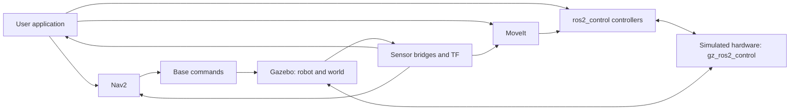

# Talk script: from a Python experiment to a robot application

The [20 October proposed redesign](TALK_FLOW.md) puts the interactive MCAP and
live-data sessions at the centre. This script retains the earlier sequence and
its reusable examples.

Working draft, 19 October 2026. This follows the proposed spoken sequence from
the latest discussion. Quoted paragraphs are suggested speech; presenter notes
specify visuals, code and evidence. The [speaker notes](SPEAKER_NOTES.md) retain
controller snippets, implementation links, measured results and rehearsal notes.
The older [deep dive](DEEP_DIVE_PRESENTATION.md) preserves the dataset/MCAP script
and historical agent evaluations.

The [slide content draft](SLIDE_DRAFT.md) turns this script into 38 slides with
speaker notes, code and media cues. Open the [highlighted slide preview](SLIDE_DRAFT.html)
in a browser. [Runnable timing examples](slide_assets/README.md) include measured
terminal output from this machine.

## Timing and scope

Proposed 45-minute allocation; not yet a timed rehearsal. Show prepared code and
recorded long robot motions. Treat nanoflann as the first section to shorten if
questions or setup take longer. Ceres/manif is backup material.

| Minutes | Section |
|---|---|
| 0–5 | Robot context, software diagram, language vote and short AI caveat |
| 5–10 | Python bottleneck, alternatives and cppyy |
| 10–15 | Why cppyy_kit, small native function, startup versus execution |
| 15–19 | rclcppyy, rclcpp_kit and C++ message ownership |
| 19–24 | Point cloud and image examples |
| 24–26 | Optional nanoflann integration |
| 26–32 | Python ros2_control controller, glue and admittance |
| 32–39 | Pick-and-place application, WBC tasks and Placo result |
| 39–42 | Separate processes versus composition |
| 42–45 | Return to AI/tooling question and audience questions |

## 1. Set the scene

> I usually work in robotics. That means autonomous systems, sensors, control,
> and a lot of data. We are at ROSCon, so I suspect that sounds familiar.
>
> For today, I set up a simulated robot with some typical ROS 2 software. We
> will use it as a playground for cppyy_kit. Here is what it looks like.

Presenter cue: play a short robot video. Show navigation, an arm motion and the
camera view. Select or record this clip before rehearsal; this document does not
assert that an edited video already exists.

> The software looks familiar too: a simulator, sensor and hardware interfaces,
> controllers, navigation, motion planning, and our application on top.

Use this conceptual diagram. It is not an exact `rqt_graph` or a process map.
For the simulator, gz_ros2_control is the simulated hardware path; on a real
robot, hardware drivers occupy that boundary. MoveIt and Nav2 are available
parts of the playground but are disabled in several recorded custom demos.



> At any of these points, you might want to try a small feature, replace a
> module, or build a whole new application. Today we will experiment in Python,
> reuse C++ libraries, and move selected work into native code when it helps.

## 2. Get a sense of the room

> Before we start: which language do you prefer when you need to get something
> working quickly? Python? C++? Rust?

Presenter cue: show of hands. Ask about preference for this task, not language
superiority. Spend about 30 seconds; do not let the vote change the demo setup.

If Python wins:

> Good, I can spend less time defending the syntax and more time showing what
> we can connect it to.

If C++ or Rust wins:

> Fair enough. Keep using it where it works for you. I want to show why Python
> can still be useful for configuring, composing and exploring those systems.

Continue:

> Python is a convenient orchestration language. We can write the task in it,
> inspect intermediate values, and call code implemented elsewhere. It is also
> a useful interface for code assistants. We still need to check what they write.

## 3. A short caveat, then back to the code

> One caveat I want to return to at the end: the way we write software is
> changing quickly. Assistants can now generate a lot of the glue we used to
> write by hand. I am excited about this kit, but its role may change too.
> Perhaps we will use it directly less often and use it more as a tool for an
> assistant. Today I want to show what it makes practical, and how we check it.

This is the presenter's view and an open question, not a forecast or a claim
that binding tools are about to become unnecessary. Keep it under 30 seconds.

## 4. The first problem: one Python operation is too slow

> Start small. We have a Python function that works, but profiling says it is
> taking too long. We know how we would write that operation in C++.
>
> One route is a native extension: write the C++, expose it to Python, build it,
> make sure Python can import it, and repeat when the implementation changes.
> That is a useful deployment model. During a small experiment, I would like
> fewer steps between changing the function and trying it again.

Presenter cue: a short workflow diagram, not a long build tutorial. CMake is
one possible build system, not a universal requirement for Python extensions.
Do not suggest that every iteration requires manually reinstalling a package.

Fill the alternatives slide with these choices:

| Approach | Where it fits |
|---|---|
| NumPy/SciPy or existing library bindings | First check whether the operation already has a native implementation. Array expressions can remove Python loops. |
| Numba | Compile supported Python/NumPy numerical code; useful when a numerical loop is the problem. |
| Cython | Add types or native interfaces and compile Python-like source into an extension. |
| pybind11 / a conventional extension | Expose a chosen C++ API with explicit bindings and a build/package workflow. |
| cppyy | Explore and call C++ APIs dynamically, including templates, callbacks and Python subclasses of C++ classes. |

Sources: [NumPy broadcasting](https://numpy.org/doc/stable/user/basics.broadcasting.html),
[Numba supported NumPy features](https://numba.readthedocs.io/en/stable/reference/numpysupported.html),
[Cython compilation](https://docs.cython.org/en/latest/src/userguide/source_files_and_compilation.html),
[pybind11](https://pybind11.readthedocs.io/en/stable/index.html),
[cppyy overview](https://cppyy.readthedocs.io/en/latest/).

> These solve different problems, and we can combine them. What interests me
> about cppyy is access to the C++ API while I am still working interactively
> in Python. That includes code I write and libraries that already exist.

Avoid claiming cppyy is always faster than these alternatives. OpenCV's Python
bindings already run native algorithms; crossing through another binding does
not automatically make those algorithms faster.

## 5. From cppyy to cppyy_kit

> cppyy gives us a lot. It also exposes integration details that matter in a
> robot application: loading headers and libraries, startup work, buffers,
> callback lifetimes, and shutting native objects down in the right order.
>
> cppyy_kit started as reusable helpers for those details. The aim is to keep
> experiments small without rediscovering the same integration failures.

Show a tiny function before a large library. This syntax example is a sum of
squares; it is not a performance comparison against NumPy's existing operations.

Vanilla cppyy:

```python
import cppyy
import numpy as np

cppyy.cppdef("""
double sum_sq(const double* x, size_t n) {
    double sum = 0;
    for (size_t i = 0; i < n; ++i) sum += x[i] * x[i];
    return sum;
}
""")
x = np.array([1., 2., 3.], dtype=np.float64)
print(cppyy.gbl.sum_sq(x, x.size))
```

With cppyy_kit:

```python
import numpy as np
from cppyy_kit import cpp
from cppyy_kit.numpy_types import NDArray

@cpp
def sum_sq(x: NDArray[np.float64]) -> float:
    """
    double sum = 0;
    for (size_t i = 0; i < x_size; ++i) sum += x[i] * x[i];
    return sum;
    """

print(sum_sq(np.array([1., 2., 3.], dtype=np.float64)))
```

Expected result: `14.0`. The docstring is C++ source, not Python translated into
C++. Annotations specify the buffer contract. The kit supplies the entry-point
wrapper and caches compiled code. [API source](../cppyy_kit/_cpp.py).

> There is still compilation on a cold path. On later runs we can load the
> compiled function. The kit also helps reuse header work and preserve native
> ownership. It does not make every pointer or callback safe automatically.

Correct the broad claim that cppyy must compile everything every time: it can
load existing libraries and already supports precompiled headers and other
precompiled facilities. Our contribution is a convenient cache and integration
workflow for these examples. [cppyy loading](https://cppyy.readthedocs.io/en/latest/toplevel.html),
[cppyy startup facilities](https://cppyy.readthedocs.io/en/latest/starting.html),
[kit caching guide](../docs/FREEZE.md).

Proposed shell-timing insert, still to rehearse: save the two snippets as
`plain.py` and `kit.py` in a scratch directory. In the same activated environment,
run each with `/usr/bin/time -f '%e s elapsed' python <file>`. Run the kit version
once with a fresh dedicated `CPPYY_KIT_CACHE_DIR`, then repeat with that same
cache. Keep the PCH state comparable. Label this process startup plus one tiny
call, not throughput. Repeat sequentially and show the distribution; no timing
claim is supplied here. For throughput, use a larger equivalent operation and
report warmed calls separately. Do not delete the shared demo cache on stage.

### Follow the syntax example with a measured cache example

> Okay, three numbers show the syntax. Now let us use Eigen to calculate a
> damped joint step. Both versions compile the same C++ operation. With the kit,
> we provide its declaration and keep the compiled implementation for later
> processes. That changes repeat startup here from 1.695 seconds to 0.319 seconds.
> The first cache-building run costs 3.948 seconds. We pay preparation once, then
> reuse it as we restart our application.

Use slides 12–14 of the [draft](SLIDE_DRAFT.md), with the complete C++ operation,
Python integration change, preparation costs and measured terminal output.
The [Eigen example](slide_assets/eigen_startup/README.md) also isolates PCH reuse:
a prepared Eigen PCH brings the vanilla path to 1.512 seconds, while the compiled
function cache avoids rebuilding the Eigen implementation. All paths check the
same result against NumPy. These are process-startup measurements.

## 6. Bring ROS into the story before processing its messages

> Our data now comes from ROS. If the next operation expects a C++ ROS message,
> it is useful to keep that message as a C++ object while Python decides what
> to do with it.
>
> rclcppyy provides an rclpy-style interface backed by the C++ ROS machinery.
> Underneath, rclcpp_kit lets us work directly with rclcpp objects and C++
> messages. The demonstrations here use that lower-level kit directly.

Use the naming from the [rclcpp_kit README](../rclcpp_kit/README.md), which links
the separate rclcppyy project. Do not call every native-stage example a drop-in
rclcppyy conversion; they use different interfaces and callback paths.

```text
ROS input → C++ message → native operation → ROS output
                 ↑ Python configures and orchestrates
```

> A Python proxy can refer to the existing C++ object. We can pass it to native
> code without first rebuilding every field as Python data. If a callback does
> not need Python at all, we can keep that callback native too.

Explain copy boundaries explicitly:

| Boundary | Claim we can make |
|---|---|
| Proxy to the existing compatible C++ object | No separate Python-message conversion is required for this direct path. |
| Python message passed into a compatibility adapter | Conversion may be required. |
| ROS middleware transport | Serialization, allocation and copying depend on the transport and configuration. |
| Cloud transform, ROS-to-PCL conversion and filtering | Our pipeline still allocates or copies data. |
| Image view | Compatible layout and retained ownership can permit a view; processing can still allocate outputs. |
| Intra-process delivery | Can avoid some transport work; does not prove end-to-end zero-copy. |

Source: [native pipeline and deployment](next_steps/pick_place/DEPLOYMENT.md).
The benefit is fewer unnecessary representation changes at specified boundaries,
not a blanket claim of no copies.

## 7. Use the data: point clouds and images

> Now we can give this a useful job. Reduce the point cloud, remove the table,
> and group the remaining points. Then use the image to select the coloured
> object we want. The scene gives us a way to inspect whether the result makes
> sense before we ask the robot to move.

Show [perception.py](next_steps/pick_place/perception.py), then the live
[native stages](next_steps/pick_place/native/). Use the
[recorded replay](next_steps/pick_place/README.md) if a live stream is unavailable.
Change one parameter, such as voxel size, and inspect both intermediate and
selected outputs.

For measured acceleration, use the recorded voxel comparison: NumPy 15.34 ms
versus PCL 1.31 ms median, with output agreement checked on the same input.
[Evidence](next_steps/pick_place/replay_evidence.json).
Do not extend those numbers to image processing, all point-cloud operations or
end-to-end ROS latency. The image example demonstrates integration and data
handling; it does not establish a speedup over cv2.

## 8. Optional: a library operation beyond the prepared kits

> What if the operation I need is not in the Python interface I already have?
> Here is a native spatial index, with a selection rule specific to my data.
> Keep the index alive and reuse it across query batches.

Use [the existing nanoflann example](next_steps/nanoflann/README.md): find nearby
observations while excluding adjacent frames and requiring minimum confidence.
Show the small Python query and the native rule. State that index construction
copies data into retained native storage. Do not claim nanoflann has no Python
wrappers anywhere; the demonstration is access to the desired native API and
custom logic without maintaining a separate extension package.

Reserve [Ceres/manif](next_steps/ceres_manif/GUIDE.md) for an optional slide or
questions: custom calibration residuals and manifold operations driven from
Python. Existing pyceres bindings are not a baseline this experiment beat.

## 9. Implement a framework interface: a ROS 2 controller in Python

> So far we have called native functions. Now let us implement behaviour that
> a native framework calls. Here is a Python controller loaded into Gazebo's
> actual ros2_control manager.

Show the [minimal GentleServo slide and configuration](SPEAKER_NOTES.md#one-slide-the-controller-specific-python).
Immediately show [the glue](SPEAKER_NOTES.md#next-slide-show-the-glue):
module/class parameters, exporter, pluginlib and the C++ call into Python.

> The short class is all the controller-specific code. A reusable bridge owns
> the ROS interfaces and calls Python. cppyy_kit builds and caches that bridge.
> CPython embedding is what makes Python execution there possible.

Use the existing [validated servo](next_steps/pick_place/README.md#python-controller-inside-gazebo),
not an unrehearsed minimal replacement. The simple controller has no Cartesian
solver. Python execution includes the GIL and is not hard real-time.

Then show the [admittance example](next_steps/pick_place/ADMITTANCE.md):

> We can keep the mass, spring and damper behaviour in Python, and make one
> native call for forward kinematics, the Jacobian and a joint-motion solve.
> Hold a browser button to apply a virtual force. Release it and the hand
> returns toward its starting pose.

Keep the synthetic-force label visible. The 1 N run moved 10.86 mm and returned
within 1.45 mm. Do not imply a wrist sensor drove that run or that this controller
has collision avoidance. [Evidence](next_steps/pick_place/evidence/admittance/live.json).

## 10. Assemble a pick-and-place application

> We now have perception, a selected object and ways to command motion. A
> pick-and-place application coordinates them: approach, reach, close the
> gripper, lift, move, release and retreat. Each stage needs feedback before
> the next stage starts.

Show the high-level sequence and [manipulation code](next_steps/pick_place/manipulation.py).
Explain that the validated application uses existing trajectory controllers.
The new Python servo and admittance controller are separate demonstrations;
we have not routed the full pick-and-place application through them.

## 11. Extend the task goals with a whole-body controller

> An arm target becomes more useful when I can also express posture, gaze,
> orientation and how much I want the torso or base to move. That is where
> whole-body task control comes in.
>
> We explored a small custom implementation and also integrated Placo. If an
> existing solver gives us the behaviour we need, we should use it. Python
> remains the place where we express and change the task.

Show position-only, orientation-only, elbow and gaze task setup from the
[WBC examples](next_steps/pick_place/README.md#change-whole-body-tasks-from-python).
Be precise about weighted preferences versus strict task priority: do not claim
an exact arm-then-torso-then-base hierarchy unless the selected backend enforces
it. Do not imply that the base had to move in the successful recorded grasp.

> Now use those task goals for the same pick-and-place sequence.

Show the [recorded Placo contact run](next_steps/pick_place/runs/placo-contact.json):
84.8 mm lift, 16.8 mm placement error, physical contact and no attachment assist.
This is one successful run. The WBC executes outside the ros2_control loop;
Placo uses its existing bindings. Its full-robot self-collision constraints are
distinct from the custom controller's limited obstacle checks. Handover remains
experimental. [Details](next_steps/pick_place/RESULTS.md#placo-controller).

## 12. Same application, different deployment

> We first kept stages in separate processes because it is easy to inspect
> their interfaces. Now keep the algorithms and compose the native stages in
> one application process, configured from Python.

Show [distributed versus composed deployment](next_steps/pick_place/DEPLOYMENT.md).
Gazebo remains separate. Discuss bounded pending work, ownership and orderly
shutdown as well as transport. Do not promise that one process is always faster:
the recorded live comparison did not establish a latency speedup.

## Closing: return to the changing role of tooling

Show the [marimo session screenshot](next_steps/agent_session/evidence/notebook-final.png)
and the [live RViz result](next_steps/agent_session/evidence/rviz_refined.png).
The notebook retained its input arrays across three agent requests. The saved
source reproduced the result in a fresh interpreter.

> Okay, this is useful. I can keep the data here, ask for a different selection,
> look at the result, and change my mind without rebuilding the whole setup.
> An agent can use that same running session.
>
> But we are carrying a compiler in the process. On this machine, just getting
> cppyy ready added about 164 MiB of resident memory and took about 150 ms.
> Our Eigen example went up to 367 MiB. With the prepared function cache it was
> about 203 MiB. Then we compiled the same source with a little CMake project
> and a pybind11 wrapper. That Python process used about 37 MiB, including NumPy.
> Nanobind was also about 37 MiB. A Rust version with PyO3 was about 37 MiB too.
> So the cache helps, but the compiler is still there. The conventional extension
> pays its compilation cost at build time.
>
> And compilation is not necessarily finished when the import finishes. A new
> template or a new call path can cause more work later. We also have ownership,
> conversions, binary compatibility and the state of this live interpreter to
> think about.
>
> So here is the workflow I want to explore. Use this flexibility to find the
> operation we actually want. While we do that, keep the input examples and
> write down what a correct answer means, including the cases that failed.
> Then take the accepted operation, build it as ordinary compiled code, and
> check it against those cases in a runtime that does not need Cling.
>
> We could keep Python around it. We could make a C++ node or plugin. If Rust
> makes sense for deployment, we could port it and use the same acceptance
> cases. That is another engineering step, but now we have a concrete operation
> and evidence to check it against.

Use the [memory table and method](slide_assets/runtime_costs/README.md).
The same guide preserves [startup, first-call, warmup and warmed-latency tables](slide_assets/runtime_costs/README.md#startup-warmup-and-per-call-p95).
When presenting them, distinguish total time for 1,000 calls from average time
per call. Batch-derived averages and individually timed p50/p95 are separate
measurements. Use the corrected common-Eigen-object nanobind comparison.

For the deployment choice, prefer the
[equal-contract point-cloud comparison](slide_assets/runtime_costs/cloud/README.md):

> We also need to compare equivalent interfaces. Here every path gets the same
> array checks. cppyy, pybind11 and nanobind call the same compiled cloud kernel.
> A full depth frame takes about 0.44 milliseconds through any of them. The
> NumPy version takes about 4.3 milliseconds. So moving the computation into
> one native loop matters here; choosing among these bindings matters much less.
> We can explore it interactively and then keep that processing speed in a
> smaller deployed process.

If asked why the separately JIT-compiled cloud kernel was faster, show the
[code-generation analysis](slide_assets/runtime_costs/cloud/CODEGEN.md):
Clang generated a loop processing two points with SIMD, while the original GCC
kernel processed one point with scalar arithmetic. The function still accepts
the count at runtime. This is evidence about these generated kernels, not about
knowing the exact cloud shape or eliminating the binding. The follow-up offline
Clang build matched the JIT at about 0.360 ms/frame through the unchanged
nanobind wrapper. We can retain this optimization in an ordinary compiled
library without carrying the runtime compiler into deployment.
The interactive session and source replay have been demonstrated. The compiled
export and cross-language acceptance workflow are the proposed next experiment.

> We started with a small Python operation, reused native libraries, processed
> ROS data, implemented a controller, and assembled a robot task.
>
> If an assistant can generate the wrappers and build files, what is still
> useful about a kit like this? For me, the question is how much code we must
> understand, maintain and verify to get from an idea to a working experiment.
> Reusable integration code can help a person or an assistant. We should keep
> measuring that benefit as the tools change.

Invite discussion rather than predicting the kit's future. Do not claim a
measured agent-productivity improvement from these robot demos: that would need
its own comparison. Return to the original promise, rapid experiments with
explicit evidence, rather than introducing another live demonstration.

The working exploration [Live experiments with an agent and Python/C++](AGENT_LIVE_EXPERIMENTS.md)
develops this closing question, including a persistent-interpreter experiment
and comparisons against generated bindings.
