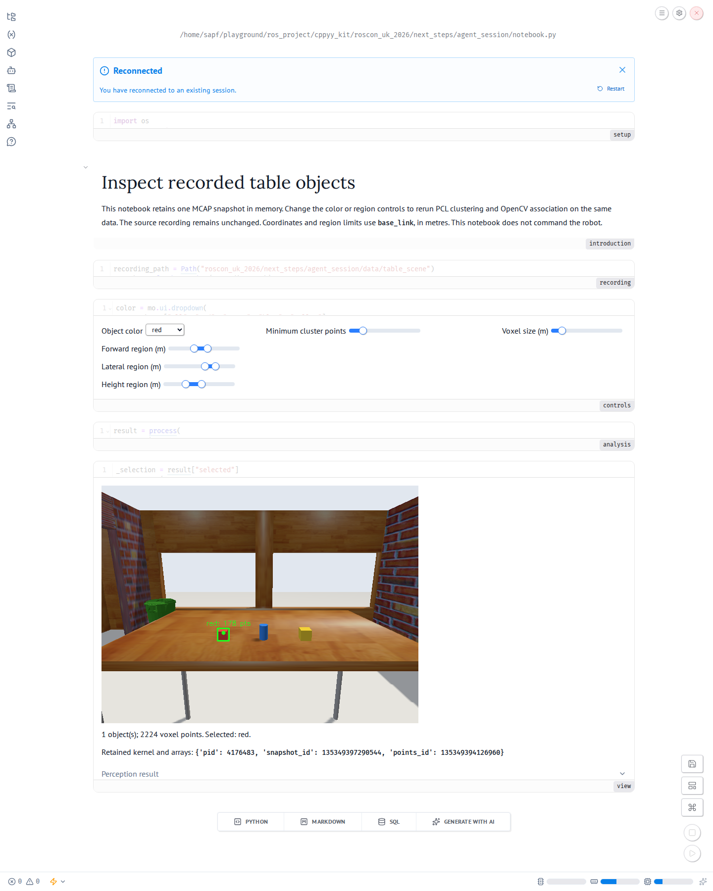

# Revise perception on one recorded snapshot

For live camera processing with the same agent interface, see the
[webcam session](../webcam_session/README.md).

Run these commands from this repository checkout. They use the existing
`pick-place` Pixi environment for ROS, PCL, OpenCV and cppyy. Optional notebook
packages go under `build/agent_session/python`. They do not change `pixi.lock`.

```bash
uv pip install --python .pixi/envs/pick-place/bin/python \
  --target build/agent_session/python \
  -r roscon_uk_2026/next_steps/agent_session/notebook-requirements.txt

roscon_uk_2026/next_steps/agent_session/notebook.sh edit \
  roscon_uk_2026/next_steps/agent_session/notebook.py \
  --host 127.0.0.1 --port 2718 --no-token --no-sandbox
```

Open <http://127.0.0.1:2718> and run the notebook cells. The accepted source
starts with the refined red object region. Expect one red cluster with 178
points and 2,224 voxel points. The overlay marks its projected center and
image region. Change the color, region, voxel size or minimum cluster control
to revise the result. The recording cell keeps the RGB image and transformed
point array in the kernel. Parameter changes rerun analysis and presentation.

The notebook reads `data/table_scene`, an MCAP recording captured from the
simulator. It uses no live subscription. Region coordinates use `base_link`
and metres. The accepted region is `[0.75, 0.10, 0.90]` to
`[1.02, 0.30, 1.08]`. Voxel size is 0.004 m and minimum cluster size is 20.
These settings describe this recording. They are not a general object detector.



## Agent access to the running kernel

Marimo 0.25.2 provides `pair execute`. Keep the browser notebook open, then
discover its stable session identifier:

```bash
roscon_uk_2026/next_steps/agent_session/notebook.sh pair notebook list \
  --url http://127.0.0.1:2718

roscon_uk_2026/next_steps/agent_session/notebook.sh pair execute \
  --url http://127.0.0.1:2718 --session <session_id> \
  -c 'import marimo._code_mode as cm; help(cm)'

roscon_uk_2026/next_steps/agent_session/notebook.sh pair execute \
  --url http://127.0.0.1:2718 --session <session_id> \
  -c 'print(retained_state); print(serializable(result))'
```

The shell wrapper prepends the optional package directory after Pixi activation.
It preserves the activated `PYTHONPATH` and native library environment.
The example disables authentication only on the loopback interface.

The scratchpad reads notebook variables. New scratchpad bindings are temporary.
Use `cm.get_context()`, `ctx.edit_cell()` and `ctx.run_cell()` to preserve accepted
code as notebook cells. Read the live cell before editing it. Do not edit the
notebook file while its kernel is active. `marimo._code_mode` is a private API.
Inspect its help in the installed version before using it. These operations
are described in the [official marimo pair implementation article](https://marimo.io/blog/notebooks-as-a-tool-for-agents)
and [official CLI source](https://github.com/marimo-team/marimo/blob/0.25.2/marimo/_cli/pair/commands.py).

## Recorded interaction

The agent issued separate `pair execute` calls against one running kernel.
The requests were scripted tool calls during this implementation session.
They were not an autonomous model benchmark.

| Request | Region and selection | Voxel points | Objects | Selected cluster points |
| --- | --- | ---: | ---: | ---: |
| 1 | Broad region, all colors, 0.008 m voxel | 9,181 | 3 | None |
| 2 | Broad region, red, 0.008 m voxel | 9,181 | 3 | 65 |
| 3 | Refined region, red, 0.004 m voxel | 2,224 | 1 | 178 |

All three reports have PID `4176483`, snapshot identity `135349397290544`
and point array identity `135349394126960`. RGB and point array identities and
SHA256 values stayed equal across calls. See [retention.json](evidence/retention.json)
and the three `iteration-*.json` reports. The matching PNG files show the outputs.
The evidence records the loaded arrays, rather than claiming that a rerun
reconstructed objects at the same Python addresses.

The first attempt to select red used `ctx.set_ui_value(color, "red")`, as shown
by the installed API help. Marimo reported `success: true` while its stderr
contained a dropdown conversion assertion. The result stayed unchanged.
[select-red-call.json](evidence/select-red-call.json) preserves this failure.
The agent then used a checked cell source edit. An initial refined request was
also run before repeating the corrected broad-red and refined sequence.
`initial-refinement.json` and `failed-dropdown-result.json` preserve those
intermediate observations. No failed request is counted in the table.

The [request files](evidence/requests) contain the actual scratchpad code.
`capture.py` reads live variables and saves evidence. `broad_red.py` and
`refine_red.py` edit only the controls cell and run its dependent cells.
The final view cell was also edited through code mode to show a compact overlay,
summary and expandable result. The browser was reloaded and reconnected to the
same session before the final screenshot.

## Replay the accepted source

Run the saved notebook in a fresh Python interpreter:

```bash
pixi run --manifest-path pixi.toml -e pick-place bash -c \
  'export PYTHONPATH="$PWD/build/agent_session/python:$PYTHONPATH"; python roscon_uk_2026/next_steps/agent_session/replay_notebook.py'

roscon_uk_2026/next_steps/agent_session/notebook.sh export html \
  roscon_uk_2026/next_steps/agent_session/notebook.py \
  --no-include-code --force \
  -o roscon_uk_2026/next_steps/agent_session/evidence/notebook.html
```

The measured replay used PID `4180209`. It reproduced both array SHA256 values,
all observations, selected object, voxel count, region, parameters and table
height exactly. Timing values differ between runs. See
[replay.json](evidence/replay.json) and the saved
[rendered notebook](evidence/notebook.html). The exported HTML is a static view.
Use the live notebook for Python execution and widget interactions.
