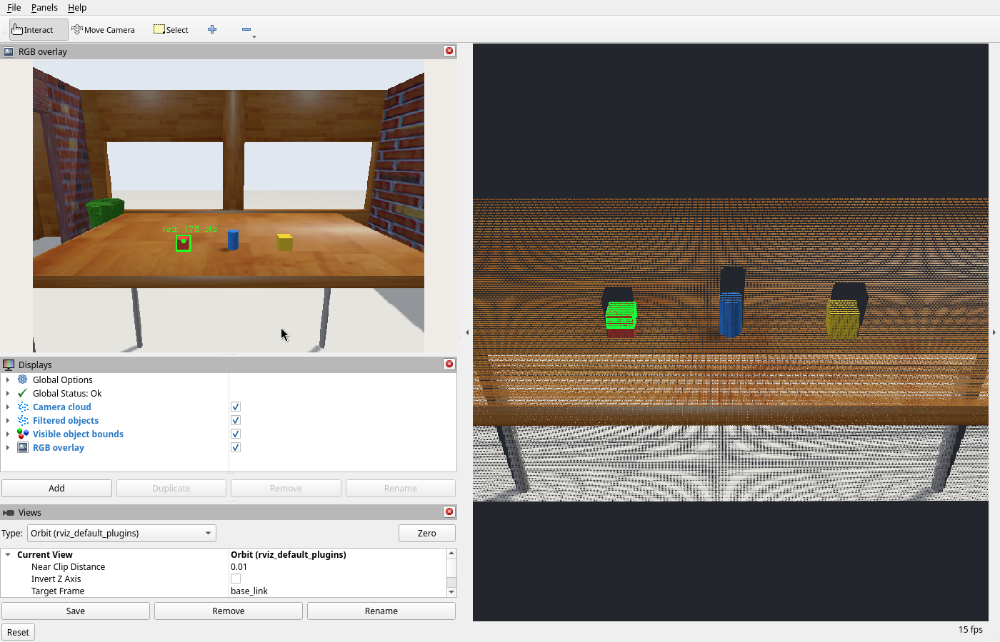

# Find a table object from recorded and live sensors

Use the same PCL and OpenCV operation in a persistent notebook and a ROS process
that publishes results for RViz. Start with the recorded scene, inspect the
candidates, then change the color, region or cluster threshold.

All commands below require this repository checkout. Run them from its root.
The existing `pick-place` Pixi environment supplies ROS, cppyy_kit, PCL and OpenCV.

## Recorded scene

The local recording is `data/table_scene/table_scene_0.mcap`: 585.7 MiB over
14.574 seconds, including 273 frames each of RGB, depth and point clouds.
Calibration, TF, clock, joint states and odometry are included. The robot is
stationary in its table-facing ready pose.

The first RGB image shows a red cube, a blue cylinder and a yellow cube.
The first cloud contains 147,131 finite points.
[Capture provenance](capture_manifest.json) records topic counts, frames,
timestamps and source hashes. The recorder reported two transport message
losses. Sensor headers use simulation time; bag record timestamps use wall time.
The large recording and generated images live in the Git-ignored `data/` folder.
Use [the capture commands](CAPTURE.md) to record another scene.


## Notebook

The notebook retains the input snapshot while controls rerun the perception
operation. It displays an image overlay, candidate measurements and the process
and array identities. Start it with:

```bash
bash roscon_uk_2026/next_steps/agent_session/notebook.sh edit \
  roscon_uk_2026/next_steps/agent_session/notebook.py \
  --headless --host 127.0.0.1 --port 2718 --no-token
```

Open `http://127.0.0.1:2718`. The optional marimo installation is local to
`build/agent_session/python`. See [the notebook guide](NOTEBOOK.md) for setup and
the recorded agent interaction. The [retention and replay report](evidence/retention.json)
checks that the input arrays survived edits and the saved source reproduced the result.

The saved notebook opens with the accepted red-object selection: ROI
`(0.75, 0.10, 0.90)` to `(1.02, 0.30, 1.08)` m, 4 mm voxels and a
20-point minimum cluster. To repeat the exploration:

1. Set color to `all`, an 8 mm voxel grid, a 12-point minimum cluster and ROI
   `(0.5, -0.5, 0.85)` to `(1.3, 0.5, 1.3)` m. Inspect all three candidates.
2. Select red and inspect the matching image region and 3D bounds.
3. Raise the minimum cluster size and observe when the small red object is
   rejected. Restore the threshold and select another color.

The accepted operation is ordinary Python in [perception.py](perception.py).
It calls the existing native PCL/OpenCV code through cppyy_kit.
The notebook source is [notebook.py](notebook.py).

## Live scene

Start one guarded simulator, if one is not already running:

```bash
cd roscon_uk_2026/next_steps/tiago_pro_jazzy
pixi run playground-headless moveit:=false navigation:=false
```

In another terminal, from the repository root:

```bash
pixi run --manifest-path pixi.toml -e pick-place \
  env ROS_DOMAIN_ID=77 RMW_IMPLEMENTATION=rmw_fastrtps_cpp \
  ROS_AUTOMATIC_DISCOVERY_RANGE=SUBNET \
  python roscon_uk_2026/next_steps/agent_session/live.py \
  --color red --duration 60
```

Open RViz in the simulator environment:

```bash
pixi run --manifest-path roscon_uk_2026/next_steps/tiago_pro_jazzy/pixi.toml \
  env ROS_DOMAIN_ID=77 RMW_IMPLEMENTATION=rmw_fastrtps_cpp \
  ROS_AUTOMATIC_DISCOVERY_RANGE=SUBNET \
  rviz2 -d "$PWD/roscon_uk_2026/next_steps/agent_session/perception.rviz"
```

RViz displays the filtered cloud, observed object bounds and image overlay on
`/agent_session/filtered_points`, `/agent_session/objects` and
`/agent_session/overlay`. Coordinates and ROI limits use `base_link`, in metres.
The `Live` class owns subscriptions and publishers so an interactive session can
retain them while revising the perception operation.

The default processing rate is 2 Hz. Each iteration captures a fresh frame.
For the accepted red-object region, add
`--roi .75 .10 .90 1.02 .30 1.08 --leaf .004 --min-cluster 20`.
The [live run report](evidence/live_continuous.json) records 13 advancing
sensor timestamps. Processing after the first native call took 3.27–42.67 ms
in that run; this excludes sensor acquisition and ROS publication.



Stop each command with Ctrl-C when finished. Follow the
[simulator guide](../SIMULATOR_LAUNCHING.md) when switching playgrounds.

## What this demonstrates

The notebook provides recorded-data inspection. RViz provides the live robot
view. Both call the same operation and show its actual sensor-derived result.
This lets an agent revise selection criteria while a person inspects the
evidence. The [design notes](../../AGENT_LIVE_EXPERIMENTS.md) describe how this
experiment informs a possible cppyy_kit session interface.
