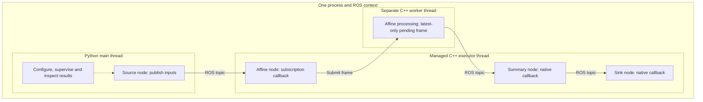

# Compose native ROS stages from Python

Run this hardware-independent experiment from the repository's `cppyy_kit` directory:

```sh
pixi run -e rclcpp python roscon_uk_2026/next_steps/composition/demo.py
pixi run -e rclcpp python -m pytest roscon_uk_2026/next_steps/composition/test_demo.py -q
```

Expect JSON confirming matching results, native progress, overload handling and
joined shutdown. Initial compilation takes longer than cached runs.

## Architectural choices

Think of four separate decisions: **what stages compute, where they run, when
work executes, and who owns the data**. A ROS node need not be a process or a
thread. Composition places multiple nodes in one process; it retains ROS topics,
interfaces and asynchronous scheduling.

| Architecture | What the developer manages | Performance implications |
| --- | --- | --- |
| Python ROS nodes in separate processes | Launch and lifecycle across processes | Parallel Python execution; transport and serialization overhead. |
| Python ROS nodes in one process | Nodes and executor callbacks | CPU-bound Python callbacks normally contend for the GIL; extensions can release it. |
| C++ ROS components in one process | Native builds and deployment | Existing native composition and intra-process communication; Python needs integration. |
| Python configures native ROS stages through this kit | Python assembly, C++ kernels and delivery policy | Native callbacks and eligible intra-process communication can reduce overhead. |
| Direct native calls without ROS | Explicit call order and data flow | Offline processing and tests; avoids ROS messaging overhead. |

The kit simplifies native assembly without handwritten per-stage bindings. ROS
composition and native extensions already provide the underlying capabilities.
Separating computation from ROS adapters could support multiple deployments. **This demo implements only
in-process ROS execution and direct kernel checks**, not interchangeable
single-process and distributed deployments.

## What this experiment implements



A single-threaded executor spins on a managed C++ thread. The affine stage uses
a separate native worker: one frame may be processing and one pending; a newer
frame replaces the pending frame. ROS history is separately bounded at depth
256. Every node enables intra-process communication. No message callback enters
Python. Python publishes inputs through a copying/conversion boundary; the
kernels also allocate/copy vectors. Zero-copy is not established.

The two kernels in [kernels.hpp](kernels.hpp) run directly and inside ROS.
Three frames are checked against an independent Python oracle. A 64-frame burst
checks overload and final delivery. Each affine operation deliberately sleeps
50 ms. Native progress during a 300 ms Python busy loop checks GIL independence.

## What becomes easier, and what can become faster

Keep one graph, one process to inspect and one managed session. Native callbacks
avoid a Python bridge at every stage. Scheduling and overload are explicit:
this example keeps recent frames. Python remains available for control and
main-thread UI integration.

Readiness, ordering and ownership remain asynchronous concerns; components share
a failure domain. This example waits for final delivery before closing. Close
cancels and joins the executor; the worker drains its pending item and joins.
Close alone does not guarantee an end-to-end drain.

Potential gains come from native computation, fewer Python crossings and less
inter-process transport. No baseline comparison is measured. Sleeping native
work proves neither CPU-bound parallel speedup nor GUI responsiveness.

## Evidence and next step

On 18 October 2026, Jazzy/CycloneDDS passed three direct and three ROS parity
checks. Of 67 inputs, five were processed and 62 coalesced; downstream stages
handled all five. Counts vary with scheduling. Native progress and joined
shutdown passed. The focused regression passed 12 tests in 42.29 s:

```sh
pixi run -e rclcpp python -m pytest roscon_uk_2026/next_steps/composition/test_demo.py rclcpp_kit/tests/test_native_pipeline.py -q
```

Next: replace simulated work with measured image processing; compare identical
computation under Python callbacks and native stages, tracking CPU, frame age
and copies. No production runtime changes, GPU work or transport changes are
included here.

Installed `rclcpp` 28.1.18 lacks EventsCBGExecutor. RoboStack lists 28.1.21/28.1.22;
no upgrade was attempted. Investigate a separate Pixi solve because 28.1.22
changes dependency naming and compiler/runtime requirements. EventsCBG is an
upstream executor to compare, not a new kit implementation.
