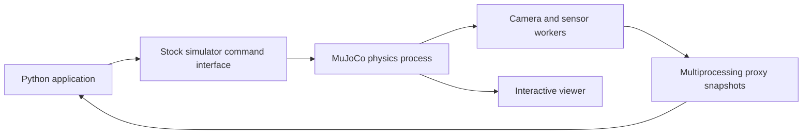

# Run the robot playground

The current verified starting robot is **Stretch 4** using Hello Robot's official
MuJoCo simulator. TIAGo single-arm, TIAGo++ and TIAGo PRO also have verified
ROS simulation baselines with user-confirmed Gazebo and RViz viewers. Robot
selection remains open.
Stretch 4 combines a wheeled base, lift, telescopic arm, wrist,
gripper, multiple cameras, depth, IMU and 3D lidar. Its default indoor scene
provides more useful sensor data than an empty floor.

These commands require this repository checkout. From this directory:

```bash
bash stretch4_probe/setup.sh
pixi run --manifest-path stretch4_probe/pixi.toml --locked probe
pixi run --manifest-path stretch4_probe/pixi.toml --locked viewer
```

The local probe verified base motion, lift motion and a 0.1 m arm extension,
head RGB at 965×1280, gripper RGB/depth at 270×480, IMU and approximately
31,000 XYZ points from each of two lidars. The interactive viewer was also
opened locally and the user confirmed the window and camera operation.

Use the [Stretch 4 setup and commands](stretch4_probe/README.md) for the selected
playground. Two independent agents installed and checked Stretch 3 and Stretch 4
locally. Both environments have separate Pixi manifests and locks. Neither
changes the main cppyy_kit environment.

## Why this robot

| Candidate | What it provides | Decision |
| --- | --- | --- |
| Stretch 4 | Official MuJoCo simulator, mobile manipulation, RGB/depth, IMU, 3D lidar, upstream Jazzy ROS bridge | Current working baseline after local motion and sensor checks. |
| Stretch 3 | Smaller official simulator, RGB/depth, IMU, 2D lidar, upstream Humble ROS bridge | Verified fallback, instructions below. |
| [TIAGo single-arm](../tiago_single/README.md) | PAL robot, ROS sensors and ros2_control | Base, arm and sensor checks passed; Gazebo and RViz user-confirmed. |
| [TIAGo++](../tiago_dual/README.md) | PAL dual-arm robot, ROS sensors and ros2_control | Base, both arms and sensor checks passed; Gazebo and RViz user-confirmed. |
| [TIAGo PRO](../tiago_pro/README.md) | PAL dual-arm robot, ROS sensors and ros2_control | Base, both arms and sensor checks passed; Gazebo and RViz user-confirmed. |

The three TIAGo environments use locked ROS 2 Humble, Python 3.12 and Gazebo
Classic 11.15.1, with dedicated Pixi environments and reusable viewer
environments. They do not establish modern Gazebo compatibility. PRO's mesh
URI, reliable robot-description delivery and camera optical-frame fixes were
verified. See each README for local adaptations and measured results.

Wrist force/torque sensors are enabled on TIAGo++ and PRO. TIAGo++ measured
approximately 4.7 N for a commanded 5 N load and approximately 0.065 N after
release. PRO measurements are finite and load-responsive, but strict magnitude
validation failed: readings of approximately 2.65 N and then 12 N for a 5 N load.
PRO's per-joint torque estimator is not ready and was skipped. Nav2, MoveIt,
grasping and a complete robot task remain unvalidated. None of these robot
playgrounds yet demonstrates cppyy_kit acceleration or native composition.

All playground simulators, viewers, bridges and ROS daemons were stopped after
the final viewer checks. The shared simulator lock is free.
Playground simulator tasks now share a process lock, so only one playground
starts at a time. Stop the active simulator before choosing another. A Python
launcher that starts a nested guarded subprocess must preserve descriptor 9
with `subprocess.Popen(..., pass_fds=(9,))`; an environment marker alone cannot
preserve the lock.

Sources: [Stretch 4 simulator](https://github.com/hello-robot/stretch4_mujoco),
[Stretch 4 ROS Jazzy bridge](https://github.com/hello-robot/stretch4_ros2/tree/jazzy/stretch_simulation),
[Stretch 3 simulator](https://github.com/hello-robot/stretch_mujoco),
[Stretch 3 ROS Humble bridge](https://github.com/hello-robot/stretch_ros2/tree/humble/stretch_simulation),
[TIAGo++ Menagerie model](https://github.com/google-deepmind/mujoco_menagerie/tree/main/pal_tiago_dual).

The direct checks use the **stock simulator**. The separate
[Jazzy ROS bridge probe](ros_bridge_probe/README.md) also passed base commands
and sensor delivery, using a narrow upstream API/readiness patch. An independent
ROS observer measured 15.05 seconds of clock progression, 0.876 m base motion
from `/cmd_vel`, and clock, joint state, IMU, odometry, scan and point-cloud
messages. It received 14 head BGR images at 1280×965 and point clouds with 7,500
points. SIGINT shutdown exited successfully without forced termination.
ROS arm trajectories, Nav2, ros2_control, WBC, reset and a full robot task remain
unverified. These checks do not demonstrate a cppyy_kit performance gain.

The simulator already has native MuJoCo
Python bindings. Its high-level wrapper uses a simulator subprocess, threads
and multiprocessing proxies. That is the baseline to inspect before proposing
composition changes.



## Verified Stretch 3 fallback

These commands require this repository checkout. From this directory:

```bash
bash setup.sh
pixi run --locked check
pixi run --locked view
```

`setup.sh` fetches upstream commit
`c78d6a1cd79bb5ead1b679610299563c1a91124a` before installing the locked Pixi
environment. Optional RoboCasa submodules and kitchen downloads are unnecessary
for this scene. The environment uses Python 3.12, upstream package 0.5.0 and
MuJoCo 3.2.6. Upstream pins that MuJoCo version for RoboCasa compatibility.
Keyboard support's `evdev` dependency comes from a prebuilt conda package because
PyPI builds failed against this host's Linux headers. No system packages were
changed.

`check` starts the stock simulator headlessly, commands lift and arm positions,
drives the base, validates sensor arrays and advancing timestamps, and shuts
down. `view` performs the same checks and leaves the interactive viewer running
until closed or interrupted. To use a limited viewer lifetime:

```bash
pixi run bash ../simulator_guard.sh -- python run_stretch.py --seconds 30
```

Outputs under ignored `artifacts/` include RGB PNGs, raw depth NumPy arrays,
`validation_headless.json` and `validation_gui.json`. Separate filenames keep
headless and visible validation evidence distinct. Display needs a working
desktop; headless rendering uses EGL. GPU compute and CUDA IPC are outside this
experiment. Hardware graphics can still be used to render simulated cameras.

### Local validation

All five stock camera streams were delivered: wrist RGB/depth at 480×270,
head RGB/depth at 240×424 after rotation, and navigation RGB at 600×800 after
rotation. Both depth arrays contained finite positive distances. Base gyro and
accelerometer each returned three values; lidar returned **360 ranges**. Camera
and sensor timestamps advanced while motion was commanded.

The first run sent several commands consecutively and failed to reach the
requested arm/lift pose. Upstream command handling uses shared read-modify-write
proxy updates; we have not isolated whether that caused this failure. The
validation now sends one motion command at a time and waits for observed state
before continuing. This is a useful integration/debugging question for the talk,
not evidence that cppyy_kit fixes the upstream simulator.

The harness calls upstream `stop()` and explicitly shuts down its private
`_manager` afterward. That private API is confined to this checkout experiment.

## Next useful experiment

Use the verified direct and ROS runs to choose a measured sensor-processing
operation for the Python, custom native and existing-library versions described
in [TALK_FLOW.md](../../TALK_FLOW.md). Complete transform, reset and arm-trajectory
checks before extending the task. ros2_control, Nav2, WBC and an end-to-end robot
task remain integration work. No speedup or zero-copy claim follows from loading
and exercising the simulator.
