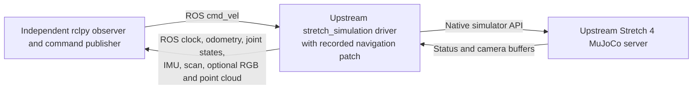

# Stretch 4: bounded upstream ROS bridge probe

This adds a conventional ROS 2 Jazzy starting point to the separate
[Stretch 4 MuJoCo probe](../stretch4_probe/README.md). It runs Hello Robot's
`stretch_simulation` driver with a small, explicit navigation patch. It does not
implement a replacement bridge, integrate cppyy_kit, or establish a complete
robot software stack.

## Run

From this directory:

```bash
./setup.sh
pixi run probe
pixi run probe-cameras
```

Run all conference playground simulators sequentially. These tasks acquire the
shared [`simulator_guard.sh`](../../simulator_guard.sh) lock and fail promptly if
another guarded simulator is running. Stop the interactive Stretch viewer before
starting a ROS probe. Use these tasks rather than invoking `probe.py` directly;
the driver subprocess inherits the guard's lock descriptor through shutdown.
Each probe starts a headless simulator, observes its ROS
messages from a separate process, commands the base, and stops its own driver.
The probes stop only their own simulator processes. Set
`ROS_DOMAIN_ID` before running if the default isolated domain 89 is occupied.
The probe defaults to CycloneDDS and EGL. It uses a separate locked Pixi
environment; it does not alter the main cppyy_kit environment or install system
packages. The setup downloads source only into this workspace.

## What is actually running



The simulator is the existing pinned source in `../stretch4_probe/source`,
revision `0b20cf4fb5faf514ac40581582f9b64aa8f96e50`.
The ROS driver is from
[hello-robot/stretch4_ros2](https://github.com/hello-robot/stretch4_ros2), revision
`4ef31733bfed3de7173f8422c5649d80a61efcef`.
The CMake-only
[ros2_numpy](https://github.com/Box-Robotics/ros2_numpy) package is used directly
from source at `1ee0d5b903ea11e440f0b02ccf0e6d1e3124aaa9`.
The harness adds their import directories explicitly; it does not install the
upstream ROS launch stack or pretend those packages were built with colcon.

## Why the local patch is necessary

The unmodified current upstream repositories do not provide a working pairing
for this test. Evidence is retained in ignored local artifacts:

- `artifacts/unmodified_navigation_failure.log`: first navigation timer fails
  because `Stretch4MujocoSimulator.set_base_velocity` no longer exists.
- `artifacts/unmodified_position_failure.log`: position mode briefly publishes
  sensor messages, then fails because camera data is not ready.
- `artifacts/unmodified_partial_sensor_observations.json`: partial observations
  before that position-mode failure; this is **not** a successful run.

[`upstream_navigation.patch`](upstream_navigation.patch) changes three base
command call sites to `sim.base.set_velocity`, skips camera publication when
cameras are disabled, and waits for the first camera buffer before using the
upstream accessor. It is applied only to the downloaded ROS driver. The selected
simulator source remains unchanged. `setup.sh` checks revisions and applies the
patch idempotently. Each successful result records the patch SHA-256.

The API migration is visible in upstream simulator history: July 22 commit
`89f56c63b8f1a5a5a8956a47124f0075d9efc71d` reorganized the API around robot
subsystems. Reverting the simulator is not a proven full solution: the earlier
API lacked newer lidar support now used by the ROS driver.

## Scope and limits

The smoke test verifies ROS base commands produce odometry motion, the simulated
clock advances, 13 joint names are published, and clock/odometry/IMU/lidar streams
arrive. With cameras, it also verifies a nonempty head RGB image and gripper
point cloud. Results and driver logs are saved under `artifacts/`.

This is a functional test, not a performance measurement: another interactive
simulator was running during initial verification. Image/point-cloud publication
is expensive in the upstream Python driver, and the stock all-camera option is
used. ROS arm trajectories, gamepad mode, Nav2, RViz, robot_state_publisher,
ros2_control and fault recovery have not been validated. Arm/trajectory handlers
still contain older generic simulator API calls and require a separate migration
before being presented as working.

The harness records whether SIGINT was enough to stop the driver, its exit code,
and whether a process-group SIGTERM was needed. See the actual JSON result before
claiming clean lifecycle behavior. The upstream launch files/system installer
assume an Ubuntu system installation and include broader hardware/UI dependencies;
those scripts were deliberately not run.

## Local verification, 2026-10-18

The patched cameras-enabled smoke test passed: the ROS simulation clock advanced
15.05 seconds and ROS velocity commands moved the base 0.876 m. The independent
observer received 80 messages each for clock, odometry, joints, IMU, scan and
gripper point cloud, plus 14 head images. The observed head image was 1280 by 965,
`bgr8`, 3,705,600 bytes; the point cloud contained 7,500 points and 90,000 bytes.
The driver exited with code 0 after SIGINT, without forced SIGTERM. These message
counts describe this smoke-test observation window, not sensor-rate benchmarks.

The successful run used patch SHA-256
`15e2b8f84d36ea11359a8c471776cd535b9807772e4da25016734d95e5f16bce`.
`bash -n setup.sh`, Python compilation of `probe.py`, locked environment setup,
idempotent patch application and upstream `git diff --check` also passed.
