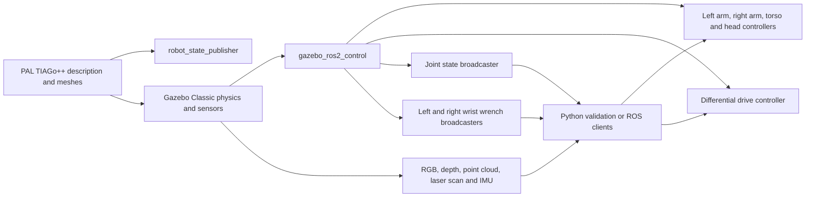

# Run TIAGo++ in a separate Pixi workspace

This repository demo runs PAL Robotics' public dual-arm TIAGo model in Gazebo
Classic with ROS 2 Humble and stock ros2_control controllers. Run these commands
from this directory in the `cppyy_kit` repository:

```bash
pixi install --locked
pixi run bootstrap
pixi run smoke
```

`bootstrap` fetches exact Git revisions and builds the selected packages with at
most two compiler jobs. `smoke` starts the simulator, verifies sensor messages
and commanded motion, then stops the processes. Expected output includes
`"passed": true` and `"forced_kill": false`. Rendering sensors need a working X
display; the local desktop uses `DISPLAY=:1`. No CUDA or Isaac Sim is used.

For interactive use, start the server and viewer in the same guarded session:

```bash
pixi run sim gui:=true
```

Run `pixi run smoke` for the integrated sensor and motion check. It moves the
robot in the empty validation world. Stop the interactive session with Ctrl+C
before running `smoke`. This workspace uses ROS domain **163** and Gazebo master
`http://127.0.0.1:11363`, distinct from the single-arm and Pro experiments.

Simulation, viewer and smoke tasks use the shared `simulator_guard.sh` lock.
Only one conference-playground simulator session may run at a time, including
Stretch and the other TIAGo variants. A competing task exits with code 75.
The smoke runner preserves the actual lock descriptor across subprocesses.
Standalone `view` cannot attach from a separate shell to an already guarded
session. Use `sim gui:=true` for the viewer. The client-only `pixi run check`
task does not start a simulator and can run alongside the protected session.
It commands both arms and the base, so use it in the empty validation world.
Use `smoke` for an integrated start, check and stop cycle.

The guarded interactive launch was subsequently verified with Gazebo and RViz
open. The user confirmed the dual-arm setup works. A client check during that
session received all eight streams and measured 0.209 m of base odometry motion
and approximately +0.150 rad on both arm joint 1 positions.

## What runs



`minimal_sim.launch.py` assembles the public model and upstream controller YAML
files using standard ROS launch, gazebo_ros, robot_state_publisher and
controller-manager spawners. It excludes PAL's optional joystick, play_motion2,
navigation and MoveIt startup. It does not replace physics, sensor plugins or
controller implementations. Eight controllers are activated: joint state, mobile
base, torso, head, left arm, right arm and two stock wrist force/torque
broadcasters. Gripper controllers have not been activated or validated.

This is the stock simulation baseline for choosing a robot. It contains no
cppyy_kit acceleration, composition changes or performance claims.

## Validation evidence

[validation.json](validation.json) records actual ROS message delivery and motion
responses. The first successful run observed:

| Check | Observation |
| --- | --- |
| Camera RGB | 640 × 480, `bgr8` |
| Camera depth | 640 × 480, `32FC1` |
| Point cloud | 307,200 points per frame |
| Laser scan | 666 ranges |
| IMU, joints, odometry and clock | Repeated messages |
| Base command | 0.211 m odometry displacement |
| Both arm joint 1 commands | +0.150 rad each for +0.150 rad targets |
| Simulation clock | Advanced 7.6 seconds during the motion phase |

The automatic smoke run also records [shutdown.json](shutdown.json). Motion
checks use controller odometry and joint feedback, not an independent external
pose measurement. The PAL ground-truth odometry plugin is built from source.
Full navigation, MoveIt planning, object tasks, gripper control and reset
behaviour remain unverified.

Both wrists publish `geometry_msgs/msg/WrenchStamped` on
`/ft_sensor_left_controller/wrench` and `/ft_sensor_right_controller/wrench`.
The upstream sensors and six force/torque state interfaces are already present.
The local launch explicitly sets their generated Gazebo `always_on` properties
to true and loads the existing PAL controller configuration files. No force
sensor implementation or vendor source modification is introduced.

The original positive-Z 5 N smoke check passed (4.704 N left, 4.665 N
right), but a dedicated directional recheck showed that this did not establish
general accuracy: an X load of 5 N measured only about 2.74 N. The issue was
native `gazebo_ros2_control` holding inactive gripper joints with kinematic
`SetVelocity(0)` calls. Those holds changed the wrist constraint reactions.

The generated model now exposes **state interfaces only for the unactuated
gripper joints**. Fingers remain passive under physics, while normal holding
behavior remains for the other joints. Gripper actuation is not supported by
this minimal launch; adding it requires a deliberately configured physical
controller, rather than restoring unused command interfaces. No vendor code,
sensor gain, force scaling or physics solver setting changes are involved.

With that narrow fix, the common check passed all **12 signed/directional force
cases** and **six pure-torque cases** across both wrists. Maximum force-vector
error was **0.153 N** and maximum torque-vector error **0.024 Nm**. Sensor and
motion regression also passed, as did repeated 5 N loads after base/arm motion
(4.941 N left, 5.017 N right). These checks establish the native measurement
path for the tested loads/poses, not realistic contact/friction behavior or a
validated force-control stack.

While the guarded simulation is running:

```bash
pixi run ft-check
pixi run ft-torque-check
```

See [the focused investigation](../WRIST_FT_INVESTIGATION.md) for original
failures, controlled comparisons, the protocol, primary source links and raw
sample locations. Force-vector error and recovery must each remain below 0.5 N;
pure-torque vector error must remain below 0.05 Nm. Thresholds were not relaxed.

## Setup and packaging notes

Conda dependencies are locked in `pixi.lock`. Git sources are locked by commit
in [sources.lock.repos](sources.lock.repos). The initial source set comes from
[PAL's public Humble manifest](https://github.com/pal-robotics/tiago_tutorials/blob/humble-devel/tiago_public.repos),
plus the dual-arm robot, navigation, simulation and MoveIt repositories,
omni_base_robot, and pal_gazebo_plugins. The original public manifest is
retained as `tiago_public.repos`. Clones, install prefixes and build outputs are
ignored. All source repositories are unmodified.

[build.sh](build.sh) lists the 19 packages actually built. The robot description,
controller configuration and PAL Gazebo plugin packages are not supplied by our
current RoboStack environment. These are the initial private-channel packaging
candidates. ROS core, Gazebo Classic 11.15.1, gazebo_ros2_control, controllers,
ROS CLI and compiler toolchain are existing RoboStack/conda-forge binaries.
Navigation and MoveIt sources are fetched but not built or claimed working.

Local integration details and mitigations:

- PAL_DISTRO must be unset. It denotes PAL's private distribution, and merely
  defining it makes upstream CMake require private module/configuration tools.
- CMake 4 accepts legacy packages with `-DCMAKE_POLICY_VERSION_MINIMUM=3.5`.
  No source patch is needed.
- run.sh and view.sh expose local package shares through GAZEBO_MODEL_PATH and
  disable the remote model database. Otherwise startup can wait for remote
  model service access.
- cyclonedds.xml restricts discovery to loopback and raises the automatic
  participant-index limit to 100. The default was exhausted by simultaneous
  controller spawners. Do not additionally set ROS_LOCALHOST_ONLY=1, which
  duplicates loopback selection in this setup.
- Image and cloud subscribers use reliable QoS, matching Gazebo publishers.
  Best-effort subscribers lost most large image/cloud samples on this host.
- Gazebo emits sensor-type and IMU noise warnings with these upstream
  descriptions. Actual scan, image, point-cloud and IMU delivery is verified.
  Classic is end-of-life; modern Gazebo remains a separate task.

No packages were published. Package recipes should use these pinned sources,
install resource-path/plugin hooks, and run the same sensor/motion smoke check.

## RViz and PlotJuggler

These commands reuse the single-arm experiment's existing isolated viewer
environments without changing their dependencies:

```bash
pixi run rviz
pixi run plotjuggler
```

The adapters override ROS_DOMAIN_ID to 163 inside the viewer environment and use
this workspace's CycloneDDS configuration. RViz resolves the dual robot meshes
from this workspace's install prefixes. Its fixed frame is base_footprint,
because the default base controller does not publish the odometry transform.

Gazebo rendered both arms, and RViz showed the dual model with global status OK.
The user confirmed both worked. The screenshot in `evidence/gazebo.png` shows
both applications during that session. PlotJuggler 4 launched with the verified
domain 163 environment, but live plotting was not established before the user
requested the next robot. Choose ROS 2 Topic Subscriber and select numeric
topics to begin streaming; no live PlotJuggler result is claimed here.

All applications from that session were handed to central cleanup when the
user requested the next variant. Continue running robot variants sequentially.
