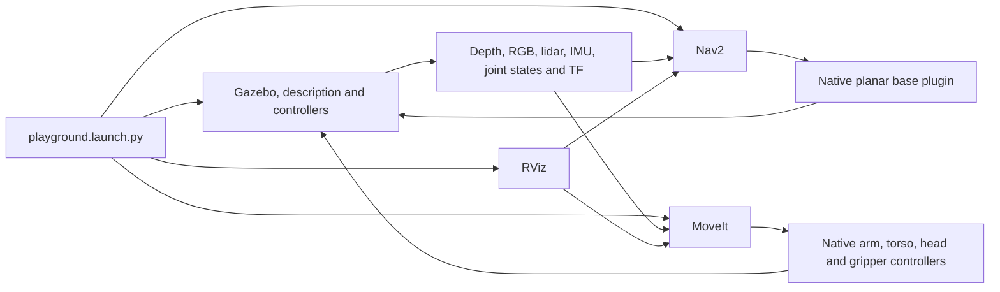

# TIAGo PRO simulation playground

For the published Jazzy/Harmonic `0.2.0` simulator, see [the Jazzy guide](../tiago_pro_jazzy/README.md). This page retains the Humble/Classic `0.1.0` baseline.

Run the home simulator, native controllers, MoveIt, Nav2 and RViz from one
launch file. This is a conventional ROS baseline for later cppyy_kit experiments,
not a demonstrated cppyy_kit performance improvement.

## Set up and start

For a standalone installation, copy the published package's
[consumer pixi.toml](../../../recipe/tiago-pro-playground/consumer/pixi.toml)
and [pixi.lock](../../../recipe/tiago-pro-playground/consumer/pixi.lock) into an
empty directory, then run:

```bash
pixi install --locked
pixi run playground
```

This installs the public `tiago-pro-playground` 0.1.0 build 2 package and its
locked dependencies without cloning this repository. Downloads total about
1.10 GiB; the installed environment occupies about 4.15 GiB of logical files.
See [installation and packaging](PACKAGING.md) for graphics requirements,
user configuration paths and build details.

For development from this checkout:

These commands require this repository checkout and an installed `pixi` command:

```bash
cd cppyy_kit/roscon_uk_2026/next_steps/tiago_pro
./setup.sh
pixi run playground
```

Setup installs the locked Humble / Python 3.12 / Gazebo Classic environment,
fetches pinned public descriptions/configuration and builds the two small
native plugin adaptations. A working graphical display is needed for camera
rendering. No system ROS installation or private PAL packages are required.

The default world is [TurtleBot3 House](worlds/home/README.md). The robot spawns
in front of its existing table, with three physical props on the tabletop.
Torso, arms, head and closed grippers initialize directly in the ready posture.
There is no startup homing trajectory or automatic manipulation demonstration.

`playground.launch.py` owns simulation, description, controller activation,
MoveIt, navigation and viewers. The rest of the stack starts after controller
activation. Subsystems use the standard launch arguments `simulation`, `moveit`,
`navigation` and `rviz`; the same file supports smaller combinations.
For example, start only the simulator and controllers:

```bash
pixi run playground moveit:=false navigation:=false rviz:=false
```

Startup first prepares the corrected model and native initial joint values,
then starts Gazebo and robot_state_publisher. Entity spawning is followed by
the joint-state, arm, torso, head, wrist and gripper controller spawners.
Successful completion starts the selected MoveIt, Nav2 and viewer processes.
These are ROS launch process events, not a custom polling supervisor.

| Launch argument | Default |
|---|---|
| `simulation`, `moveit`, `navigation`, `rviz`, `gui` | `true` |
| `world`, `map` | Bundled `worlds/home/home.world` and `map.yaml` |
| `spawn_x`, `spawn_y`, `spawn_yaw` | `-2.65728`, `1.35`, `1.5707963267948966` |
| `rviz_config` | Existing `playground.rviz` |

Pass overrides after the task, for example
`pixi run playground rviz_config:="$PWD/my_layout.rviz"`.
`pixi run view` and `pixi run headless` start only simulation/controllers.
Against an existing bare simulator, `pixi run moveit`, `pixi run navigation`
and `pixi run rviz` attach those subsystems through the same launch file.
Do not attach duplicate servers to a full stack.

Use `pixi run playground-headless` for the full stack without GUI windows.
Run only one playground simulator at a time. The shared guard rejects a second
one with exit code 75. It does not stop an existing simulator for you.

## Use the robot

In RViz, keep **Fixed Frame** set to `map`:

- **Nav2 Goal**: click and drag on the map to choose a destination and heading.
- **MotionPlanning**: select `arm_left` or `arm_right`, drag a goal with
  **Interact**, then **Plan**. Inspect the animated preview before **Execute**.
- Select `both_arms_torso` and named goal `ready` to restore the ready posture.
  The older `both_arms/compact` goal is available but is not the default.
- Select `gripper_left` or `gripper_right`, choose `open` or `closed`, then
  plan and execute. The native screw travel is 0.000–0.070 m, not jaw aperture.
- Select `head` and `center`, `look_left` or `look_right`, or edit its two joint
  goals in **Joints**. The head supports joint-space goals rather than Cartesian IK.

The normal **Plan** button creates its own preview. No helper publisher is
needed. `State Display Time = 0.05 s` gives working native playback in this
build; it changes preview timing only. Keep **Show Trail** disabled to avoid
rendering many complete robot copies. The native trajectory slider supports
pause and manual scrubbing.

The map, front/rear laser scans, global `/plan` and local `/local_plan` displays
are separate. A fresh local path appears while the Nav2 controller is working.
Enable the head cloud display to inspect raw depth; MotionPlanning's scene
geometry shows the collision occupancy derived from that depth.

Save your layout with RViz **File → Save Config** or **Save Config As**.
The launcher uses `playground.rviz` by default. Startup does not regenerate
that file. Keep a separate saved copy for personal layouts. Reattach a viewer
to an already running stack with `pixi run rviz`; do not start another simulator.

## What runs where



| Interface | ROS name |
|---|---|
| Base velocity | `/mobile_base_controller/cmd_vel_unstamped` (`Twist`) |
| Arm trajectory actions | `/arm_left_controller/follow_joint_trajectory`, right counterpart |
| Torso/head trajectory actions | `/torso_controller/follow_joint_trajectory`, `/head_controller/follow_joint_trajectory` |
| Gripper actions | `/gripper_left_controller/gripper_cmd`, right counterpart |
| State and odometry | `/joint_states`, `/mobile_base_controller/odom` |
| Wrist force/torque | `/wrist_left_ft_broadcaster/wrench`, right counterpart |
| Depth cloud | `/head_front_camera/depth/color/points` |
| Front/rear lidar | `/scan_front_raw`, `/scan_rear_raw` |

Trajectory actions use `control_msgs/action/FollowJointTrajectory`; grippers
use `control_msgs/action/GripperCommand`. Avoid competing command sources for
the same device. Gripper control uses a native effort controller and physical
mimic followers; contact-rich grasping is not established by free-space movement.

## Frames and limitations

Navigation uses simulation truth: the native base plugin publishes world-based
`odom → base_footprint`, with identity `map → odom`. This is not AMCL or SLAM.
The house map is an initial raster of known collision primitives, supplemented
by lidar costmaps; it is not complete proof of doorway clearance.

MoveIt's native floating virtual joint tracks `odom → base_footprint` through
TF. Its world-fixed planning frame prevents depth occupancy from accumulating
in a moving base frame. Depth builds the collision Octomap; no manual ground,
table or prop shapes are injected. Unseen surfaces and small props may be
missing. **Clear Octomap** discards stale observations after a reset.

Nav2 uses a padded 1.10 × 1.00 m footprint for the ready posture. It does not
plan the swept volume of arbitrary arm motion. The omnidirectional base plugin
drives the chassis directly; wheel traction, slip and visual wheel rolling are
not modeled by this control path. Per-joint measured torque is not available.

This baseline has recorded native arm, head and gripper execution, Nav2 arrival,
and wrist-load evidence. It does not establish autonomous grasping, WBC,
hardware equivalence, or a cppyy_kit acceleration/composition result.

## Stop and maintain

Press **Ctrl-C** in the owning launch terminal to stop the stack. Wait for its
processes to exit before launching another robot. Closing a viewer does not
mean the simulator has stopped. The stack uses domain **77**, Fast DDS and
Gazebo master **11377**; its Pixi tasks set these consistently.

The canonical corrected description is `generated/robot_description.urdf`.
Generated models/configuration are under `generated/`; optional check reports
are under `artifacts/`. Native ROS launch prints its log directory at startup
(normally `~/.ros/log`). Edit source configuration rather than the expanded model.
`pixi.lock` and each `sources.lock`
record binary and source pins. Rebuild changed adapters with
`pixi run build-planar-plugin` or `pixi run build-gripper-plugin`.

Detailed references:

- [MoveIt setup and optional manual checks](moveit/README.md)
- [Navigation frames, map and footprint](navigation/README.md)
- [Physical grippers and controller evidence](gripper/README.md)
- [Wrist force/torque investigation](../WRIST_FT_INVESTIGATION.md)
- [Shared simulator ownership](../SIMULATOR_LAUNCHING.md)

Manual checks such as `control-check`, `joint-control-check`, `gripper-check`
and the wrist load clients command real simulated motion or forces. They are
maintenance tools, not startup steps. Run them only with other command sources
idle and after reading their scope in the relevant reference.
