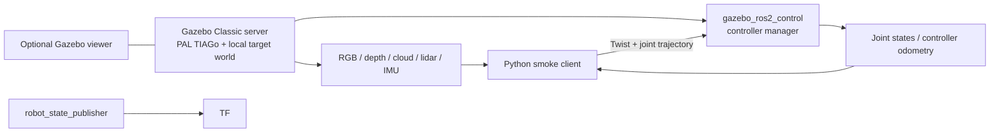

# TIAGo single-arm playground

Run the public PAL TIAGo model with simulated sensors and ros2_control. This is
an isolated Pixi workspace for comparing robots for the ROSCon session.
It does not yet demonstrate cppyy_kit acceleration.

From this directory in this repository checkout:

```bash
bash setup.sh
pixi run view
```

In another terminal in this directory:

```bash
pixi run check
pixi run stop
```

`view` opens Gazebo. `run` starts the server without its viewer. Both require
an X display for camera rendering; local validation used `DISPLAY=:1`.
`check` requires a running simulation and commands a short, slow base movement
and a 0.15 rad arm-joint movement. It overwrites [smoke.json](evidence/smoke.json)
and [camera.png](evidence/camera.png).

Run one robot simulation at a time. `run`, `view` and the direct `run.sh`
entrypoint use the shared [simulator guard](../simulator_guard.sh). A second
playground launcher exits with code 75 while the first owns the lock. Nested
launchers inherit the actual lock descriptor; the Python manager preserves it
for the child launch process. `check` is a client of the running simulator and
starts no simulator, so it does not acquire a second lock. `stop` also remains
available while the simulation owns the lock.

Closing a GUI does not stop its server. Use `pixi run stop` and wait for shutdown
before selecting another robot. The manager signals its own launch process group
and escalates only that group if shutdown stalls. It does not kill other
simulators. The shared guard coordinates these playground launchers; it does not
manage unrelated simulators started outside them.

## Inspect live topics with RViz

With the simulator running, use another terminal in this directory:

```bash
pixi run rviz
```

RViz has its own [tools environment](tools/pixi.toml). Installing or launching it
does not change the running simulator's Pixi prefix. It uses the same ROS domain
161 and Cyclone DDS configuration. It is a viewer and does not acquire the
simulator lock.

The saved [RViz configuration](tiago.rviz) shows the robot model, base lidar,
RGB-D point cloud and RGB image. Its fixed frame is `odom`; the camera follows
`base_footprint`. TF axes and the raw depth image are optional displays. The
model description uses transient-local durability so a newly attached viewer
receives it. Large image/cloud subscriptions use reliable delivery. The raw
depth Image display can appear black with RViz's normalization; the registered
point cloud and the smoke test provide separate depth-data checks.

The isolated viewer was checked against the live simulator: RViz's global
status was OK, PAL meshes rendered, the RGB panel showed the red target and
point cloud/lidar data appeared. See [RViz evidence](evidence/rviz.png).

## What worked locally

The locked environment contains ROS 2 Humble, Python 3.12 and Gazebo Classic
11.15.1. PAL robot descriptions and controllers are built from pinned public
sources. A minimal local launch replaces the full PAL application launch so
that simulation does not depend on installing navigation, joystick applications,
MoveIt and the play_motion2 server first. The robot model and control
configuration remain PAL's implementations.

Verified on 2026-10-18:

| Check | Observed result |
| --- | --- |
| Simulated time | Advanced 7.4 s during the isolated visual smoke test |
| Differential base command | 0.508 m controller-odometry displacement |
| Seven-joint arm trajectory | Joint 1 changed by 0.150001 rad for a 0.15 rad request |
| RGB and depth | Repeated 640 x 480 images; depth had 37.6% finite positive values |
| Point cloud | Repeated 640 x 480 clouds with 9,830,400 data bytes each |
| Lidar | Repeated scans with 666 ranges |
| IMU and joints | Repeated deliveries, not just advertised topics |
| Controllers | Base, arm, torso, head, gripper and joint-state broadcaster activated |
| Shutdown | Server and robot-state publisher exited after SIGINT; GUI required SIGTERM |

The camera, depth, point cloud, scan and IMU checks require repeated messages.
Large images and clouds use reliable subscription QoS; the initial best-effort
cloud subscription received only one message in 40 seconds on this host.
This is not a performance benchmark or a physical accuracy validation.



## Current limitations and next check

The three robot trials were initially launched concurrently. Their Classic GUI
views conflicted and displayed overlapping models. After stopping every trial,
the single-arm simulation was relaunched alone through `pixi run view`. The
viewer rendered one single-arm TIAGo and the local red target, and the full
motion/sensor smoke passed again. See [the isolated viewer](evidence/viewer.png).
The blue rays visible in that image are the lidar visualization.

The tested simulator configuration retains world name `default`, its own master
port and ROS domain. Shared serialization replaces the earlier process-scanning
guard. The actual lock descriptor was present in the manager, ROS launch and
server; a second benign guarded command exited 75 while this simulation ran.
The new guard integration and isolated viewer are now runtime verified.
This latest GUI session was left running for the user's visual check; its
shutdown has not yet been exercised. The previous session's shutdown result is
recorded above.

ROS Nav2, MoveIt, full PAL bringup/play_motion2 and autonomous tasks have not
been validated. The IMU reports Classic noise-index warnings; sensor messages
arrive, but the noise model has not been assessed.

Classic was selected because the official public Humble instructions use it
and RoboStack provides the required binaries. It reached a complete motion and
sensor proof quickly. Classic is end of life. This is a selection experiment,
not a recommendation for a new production deployment. Upstream also has a
modern Gazebo launch path (`gazebo_version:=gazebo`) and RoboStack Humble has
`ros-humble-gz-ros2-control` and `ros-humble-ros-gz` binaries. That route was
researched but not installed or run here. No claim is made that it is blocked.
A supported Gazebo target should be evaluated before packaging a conference
installation environment.

## Reproducibility and packaging

- [pixi.toml](pixi.toml) and `pixi.lock` define this workspace's binary environment.
- [source-lock.repos](source-lock.repos) records exact upstream Git SHAs.
- [setup.sh](setup.sh) imports those commits, applies the one patch idempotently,
  and builds selected packages with at most two compilation jobs.
- [single.launch.py](single.launch.py) is the explicit, limited launch assembly.
- [PACKAGING.md](PACKAGING.md) lists source packages and integration changes.

The first install/build has not been repeated from a completely fresh checkout;
the environment install, selected source build and actual running robot have
been verified incrementally. Vendor checkouts, build artifacts and logs are
ignored. No apt packages, Docker images or external ROS installation are needed
by these scripts.

References: [PAL simulation instructions](https://github.com/pal-robotics/tiago_simulation/tree/humble-devel),
[public repository manifest](https://github.com/pal-robotics/tiago_tutorials/blob/humble-devel/tiago_public.repos),
[PAL robot model](https://github.com/pal-robotics/tiago_robot/tree/humble-devel).
